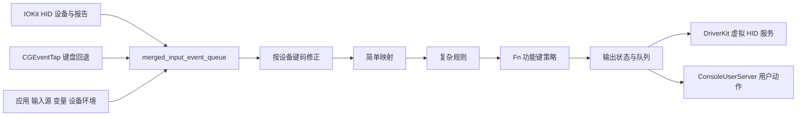
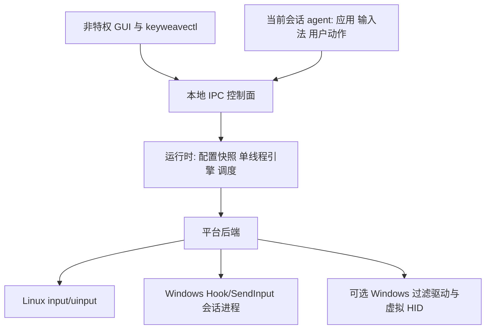

# KeyWeave 开发指导文档

ADR-0182：新增独立keyweave-x11-probe只读executable，显式本地display/event node/major/minor，查询XI2 Device Node/Enabled及已启用master的slave classes；不读按键/坐标/标题，不抓取/改属性。字段/类/原子property长度有界，SDK allocator RAII、root-trust动态库；Xlib故障隔离于capturer之外。新增 5 tests，Linux 1694 项测试及 Clippy、格式、源码60/既有C ABI通过。X11真实SDK oracle已执行但缺Xlib.h而失败，未连接显示，ABI/native query未证明；不当readiness。owned child超时/协议验证/consumer gate、Wayland、mixed host/worker、Windows原生pointer/补验、硬件、GUI、包装和driver继续。复用锁定依赖，新增private unsafe边界。见 [ADR-0182](ADR-0182-isolated-x11-probe.md)、[验证记录](validation/linux-2026-10-14-x11-probe.json)。

ADR-0181：新增sd-login图形会话只读NativeSessionProbe与SessionObserver，固定parent/worker/非root UID，双快照active/nonremote/user/seat及x11/wayland；TTL250ms从query前起算，clock/late/query/identity异常清证据，锚定会话不重绑定。private动态SDK符号/有界malloc字符串free/parent和UID前后核验，不取设备控制权。新增 9 tests，Linux 1689 项测试及 Clippy、格式、源码60/标量C ABI通过。SDK headers缺失且sandbox系统库UID65534使root-trust拒绝加载，native exports/query未验证；未放宽检查。SessionReady不是consumer/capture/focus/解锁proof。真实图形consumer、mixed bootstrap/host/worker、Windows pointer/原生补验、硬件、GUI、包装和driver继续。新增private unsafe FFI边界，无新依赖。见 [ADR-0181](ADR-0181-linux-graphical-session-observer.md)、[验证记录](validation/linux-2026-10-14-graphical-session.json)。

ADR-0180：Linux 显式 PointingButtons/DeviceSpec 支持 BTN_LEFT..TASK↔button1..8，canonical非descriptor证明；pointing normalizer保存Down，Up/Repeat沿旧身份。relative Capture支持这些按钮/POINTER属性，输出需X/Y、PROPBIT及精确node proof；默认keyboard mapper/能力/Runtime与Console保持拒绝。native pump按实际spec编码，按钮→键、键→按钮、拖动/旧Arc/已接受按钮停止恢复均接同一stage/ledger。新增 10 tests，Linux 1680 项测试及 Clippy、格式、源码60、button/property C UAPI通过，无真实设备操作。graphical consumer授权、host/worker scope、Windows原生pointer/补验、硬件、GUI、包装和driver继续。无新unsafe边界/依赖，private PROPBIT白名单已核验。见 [ADR-0180](ADR-0180-linux-pointing-buttons.md)、[验证记录](validation/linux-2026-10-14-pointing-buttons.json)。

ADR-0179：新增显式 CaptureDevice.new_with_relative / Runtime.new_staged_relative，连接原生解码→Activity注册→原帧缓存→实际receipt→mixed pump。key顺序切relative run，保值/轴顺序；全batch预检/预算，Source预算先于controller，控制/stop清帧，短写input-close-first/report/已知键恢复保持。默认工厂及Console CaptureGroup不接新scope；当前已有keyboard/consumer+相对轴组合设备，普通mouse按钮/完整pointer属性和consumer授权仍继续。新增 12 tests，Linux 1670 项测试及 Clippy、格式、源码60/C UAPI通过，无真实设备操作。host/worker relative交付、Windows原生补验、硬件、图形providers、GUI、包装和driver尚待完成。无新增unsafe/FFI/依赖。见 [ADR-0179](ADR-0179-linux-relative-runtime.md)、[验证记录](validation/linux-2026-10-14-relative-runtime.json)。

ADR-0178：新增 OS 无关 PointerActivity 摘要，一帧一次资格/转发，scrolled 取消 Alone；PhysicalStep 返回实际注册 pointer source。Linux PendingRelativeFrames 持原帧/设备/时间/旧Arc，以实际 receipt source/身份/摘要/时间冷核验后一次取回；8192 records/4096 frames、source严格递增，撤销/Reset不重用。新增 9 tests 通过真实 controller 验证 high-res原值、timed FIFO/reload、撤销、资格对照、非法receipt、预算和injected bypass。Linux 1658 项测试及 Clippy、格式、源码60/C UAPI通过。默认 keyboard machines 继续拒绝 Activity；packet capture/consumer授权/Runtime接线、Windows原生补验、硬件、图形providers、GUI、包装和driver尚待完成。无新增 unsafe/FFI/依赖。见 [ADR-0178](ADR-0178-relative-frame-stage-correlation.md)、[验证记录](validation/linux-2026-10-14-relative-correlation.json)。

ADR-0177：DeviceSpec 显式 with_relative_axes，uinput 创建设置 EV_REL/RELBIT，生产 FrameBackend 已声明并写出 relative。提取 OutputChannel<W> 共用状态机，Uinput 独占 File/身份/RAII/反馈不变；normal/relative 共用 report/recovery/quarantine。evdev 查询16位 relative mask，OutputNodeReady 精确验轴，physical keyboard 仍拒绝 pointer。新增 10 tests，Linux 1649 项测试及 Clippy、格式、源码60、扩展 REL_MAX/RELBIT/query C UAPI 核验通过。未运行真实设备；pointer receipt 原帧关联、consumer授权和 Runtime capture 接入继续，Windows 原生补验、硬件、图形 providers、GUI、包装和 driver 尚待完成。private scalar ioctl 白名单扩展已核验，无新 unsafe 边界/依赖。见 [ADR-0177](ADR-0177-linux-native-relative-output.md)、[验证记录](validation/linux-2026-10-14-native-relative.json)。

ADR-0176：Linux OutputPump 已加入同一有界 mixed FIFO 的 KeySpan/RelativeFrame 屏障，OutputQueue bounded begin_due_limited 不跨指针分批；总8192事件、全步能力/容量冷预检和时间归一。relative 完整接受不动 key ledger，短写先 REPORT 后已知键恢复、不重发相对值；unknown/非法 receipt quarantine，stop 丢未来 pointer，pending relative 不算中立。Runtime 期限查询改用完整 pump deadline；默认 backend/Uinput 仍无 relative 声明。新增 11 tests，Linux 1639 项测试及 Clippy、格式、源码60、C UAPI核验通过。实际 uinput/probe/consumer/Runtime pointer接入、Windows 原生补验、硬件、图形 providers、GUI、包装和 driver 尚待完成。无新增 unsafe/FFI/依赖。见 [ADR-0176](ADR-0176-linux-mixed-output-pump.md)、[验证记录](validation/linux-2026-10-14-mixed-pump.json)。

ADR-0175：Linux 新增显式 RelativeAxes 与预检 RelativeFrame，白名单 X/Y、两轴传统和高分辨率 wheel，保原顺序/重复轴/零值/i32，不合并或换算；activity 只报告非零移动/滚动。一次写出复用既有 Layout/REPORT/prefix 分类，空帧零写、errno/非对齐/超长保持 UnknownAcceptance，无重发。新增 8 tests，Linux 1628 项测试及 Clippy、格式、60 项源码哈希核验、扩展 C UAPI relative codes 核验通过。仍未放宽键盘 Runtime/设备准入；relative 输出泵、uinput/probe/consumer 与 mixed 原生接入继续，Windows 原生补验、硬件、图形 providers、GUI、包装和 driver 尚待完成。无新增 unsafe/FFI/依赖。见 [ADR-0175](ADR-0175-linux-relative-frames.md)、[验证记录](validation/linux-2026-10-14-relative-frames.json)。

ADR-0174：keyweavectl validate/import/replay 已支持显式 staged-keyboard，默认 Legacy 保持；schema 2 用严格 input/advance/activate，实际 Physical controller 按 deadline 驱动，无假 timer seq/自动未来完成。保旧 Arc、真实状态/变量、pointer receipts 的键盘先后计数和 repeat 查询，工作/输出有界。新增 9 tests 与 6 fixtures，真实 CLI 覆盖窗口端点/超时、duration/reload、设备撤销、变量/pointer、未完成窗口及非法 schema/时间/身份。Linux 1620 项测试及 Clippy、格式、60 项源码哈希核验通过；doctor 区分后端代码与原生验收。Windows 原生补验、native pointer、硬件、图形 Linux providers、GUI、包装和 driver 尚待完成。无新增 unsafe/FFI/依赖。见 [ADR-0174](ADR-0174-staged-cli-replay.md)、[回放说明](REPLAY.zh-CN.md)、[验证记录](validation/linux-2026-10-13-staged-cli.json)。

ADR-0173：新增 CompileMode 与 compile_with_mode，仅显式 StagedKeyboard 接受 Complex simultaneous；默认 compile/load_config/keyweavectl/Legacy 继续 KW-SIM-001。Linux/Windows PreparedConfig 按固定会话模式编译，原 bytes/generation、整规则禁用、平台能力和原生输出冷预检保持；启动与 reload 共用工厂。新增 11 tests，并更新真实 host CLI 检查；冷准备线程与实际 Windows actor 证明 apply 后 ack、旧组保旧 Arc及模式拒绝。Linux 1611 项测试及 Clippy、格式、60 项源码哈希核验通过；J+K 示例经两平台离线 check。Windows 原生补验、native pointer、硬件、图形 Linux providers、GUI、包装和 driver 尚待完成。无新增 unsafe/FFI/依赖。见 [ADR-0173](ADR-0173-staged-chord-compilation.md)、[验证记录](validation/linux-2026-10-13-chord-compilation.json)。

ADR-0172：Linux Runtime 与 Windows SessionActor 的显式 StagedKeyboard 工厂已接入完整 Physical 组合键模型，模式冷校验同路。继续复用时钟、来源域、64-work、输出泵与 accepted ledger；Windows repeat 只跟实际已接受 desired leaf，Linux 保持 Kernel repeat。新增 12 tests 覆盖跨设备 all-up、窗口端点/超时、reload、完整 after-up 能力检查、撤销/停止及零接受失败。Linux 1600 项测试及 Clippy、格式、60 项源码哈希核验通过。Legacy 和 compiler KW-SIM-001 仍严格；用户配置能力接入、Windows 原生补验、native pointer、硬件、图形 Linux providers、GUI、包装和 driver 尚待完成。无新增 unsafe/FFI/依赖。见 [ADR-0172](ADR-0172-staged-session-chords.md)、[验证记录](validation/linux-2026-10-13-session-chords.json)。

ADR-0171：Physical new_with_chord_model 已接通同一 Simple/Complex 模型，Output 保持低位来源域，Physical/pointer 原来源保持高位域。预算覆盖每个可能 primary 成员、全组抬键分支及其修饰键，Simple 目的键沿同一表展开；旧 root lease 保留至真实完成，reload 只改变新 root。新增 8 tests，Linux 1588 项测试及 Clippy、格式、60 项源码哈希核验通过。默认 Native 工厂与 compiler KW-SIM/runtime gate 仍关闭；统一原生模式、native pointer/repeat、Windows 原生补验、硬件、图形 Linux providers、GUI、包装和 driver 仍待完成。无新增 unsafe/FFI/依赖。见 [ADR-0171](ADR-0171-physical-chord-source-leases.md)、[验证记录](validation/linux-2026-10-13-physical-chord.json)。

ADR-0170：公共 Simple/Complex new_with_chord_model 已接通同一引擎模型，完整 Complex simultaneous 旧 Arc 保留，Simple simultaneous 仍拒绝。生成队列构造/旧计划/选择/reload 使用固定角色；Simple 传实际队首 event history frontier 和 device idle/EOF，窗口不阻塞阈值内排队输入。Scope close 以有界工作等待 body 原 Up 真正进入 Complex，不等待整组退休；wheel 历史避免匹配后误触 Alone，Reset/设备控制清理。新增 10 tests，Linux 1580 项测试及 Clippy、格式、60 项源码哈希核验通过。默认构造、Physical/Native 工厂和 KW-SIM/runtime gate 仍关闭，完整 Physical 来源预算/模式、native pointer/repeat、Windows 原生补验、硬件、图形 Linux providers、GUI、包装和 driver 仍待完成。无新增 unsafe/FFI/依赖。见 [ADR-0170](ADR-0170-simple-chord-model-handoff.md)、[验证记录](validation/linux-2026-10-13-simple-chord-model.json)。

ADR-0169：Complex 新增持有原输入的有界自动仲裁与 replay 队列，显式 frontier 阻止晚 poll 提前超时，阈值端点保持包含。首个 Ordinary/Pass 使用保存选择，其他输入原序重新仲裁；实际准入用当前时钟，原事件历史保留，Alone 回放按原跨度判定。旧 Delayed canceled 分支先更新生成视图，64-work Yield 续排，变量中立/consumer 外部按键、设备撤销和 Reset 已接入。新增 15 tests，Linux 1570 项测试及 Clippy、格式、60 项源码哈希核验通过。默认构造和 KW-SIM/runtime gate 仍关闭；Simple 真实 frontier、EOF/同步与 Scope/指针混合流、完整来源预算、native repeat 和平台验收尚待接通，Windows 原生补验、GUI、包装、driver 继续待做。无新增 unsafe/FFI/依赖。见 [ADR-0169](ADR-0169-complex-arbitration-scheduler.md)、[验证记录](validation/linux-2026-10-13-actor-arbitration.json)。

ADR-0168：共享组任一成员的 descendant projection 指向同一 primary 模板，每个引用保留原设备身份。匹配前模板合并，非空主输出用共享 Down 与 born-projected Output 联合准入；空 main 和普通/全组抬键分支继承投影。设备控制清除已取消的输出 ID，按引用原设备移除失效引用，保留其他设备引用；最后失效引用显式清理仍存活模板和预算，避免取消输出重现。新增 10 tests，Linux 1555 项测试及 Clippy、格式、60 项源码哈希核验通过。测试区分变量 pause/up 值、普通 close FIFO 与即时 control restore。默认构造和 KW-SIM/runtime gate 仍关闭，自动仲裁/frontier/回放、完整 Simple/Physical 组路径、来源预算与 native repeat 尚待接通；Windows 原生补验、指针、硬件、GUI、包装和 driver 仍待验收。无新增 unsafe/FFI/依赖。见 [ADR-0168](ADR-0168-shared-group-projections.md)、[验证记录](validation/linux-2026-10-13-group-projections.json)。

ADR-0167：任一保存成员设备移除或被新 generation 替代时，Complex 先核验设备双历史，再撤销整组实际输出和候选，随后解除共享保留。存活设备的未抬键成员保留取消后的空绑定，其原 Up 只退休，不触发抬键分支；同批次未来动作和其他组的同键 owner 保持独立。已见 Up 的存活成员完成报告经 Simple 控制路径转交，Physical 原收集逻辑继续处理来源 lease。新增 8 tests，Linux 1545 项测试及 Clippy、格式、60 项源码哈希核验通过。默认构造和 KW-SIM/runtime gate 仍关闭，自动仲裁/frontier/回放、投影、完整来源预算与 native repeat 尚待接通；完整 Simple/Physical 组回放、Windows 原生补验、指针、硬件、GUI、包装和 driver 仍待验收。无新增 unsafe/FFI/依赖。见 [ADR-0167](ADR-0167-cross-member-group-cancellation.md)、[验证记录](validation/linux-2026-10-13-group-device-cancel.json)。

ADR-0166：实际 ChordArbiter 的匹配结果已能交给同一个 Complex actor，复用输入表、共享绑定、Output 和孩子退休路径。成员 Up 统一管理 any/all、普通和全组抬键分支；Held 替换更新全成员主孩子，Delayed 保留原绑定。lookahead 初始 Up 作为有界工作排在到期输出后、定时器前；Alone 使用原事件跨度，生成使用实际时钟。Reset 在输出重置后显式解开共享保留，不伪造未执行键的 Up。新增 14 tests，Linux 1537 项测试及 Clippy、格式、60 项源码哈希核验通过。匹配交接在内部构造的同一 actor 中验证；默认构造和 KW-SIM/runtime gate 仍关闭，自动仲裁/frontier/回放、跨成员设备撤销、投影、来源预算与 native repeat 尚待接通。Windows 原生补验、指针、硬件、GUI、包装和 driver 仍未完成。无新增 unsafe/FFI/依赖。见 [ADR-0166](ADR-0166-complex-shared-group-execution.md)、[验证记录](validation/linux-2026-10-13-complex-groups.json)。

ADR-0165：GroupAfterKeyUp 从保存 simultaneous options 生成全组抬键 tap，使用当前修饰键减 consumed、旧 Arc；owner 自动记 pending，finish 不可跳过，最后原 Up 成员提供 fresh 条件身份，主成员继续拥有输出生命周期。联合子计划准入后才终结 pending；过滤/halt 空分支一次结束，失败锁存并保共享 hold。新增 6 tests 覆盖 any/all 全 Up、旧配置/定时数组/一次执行、last-device Unknown/unless/过期、halt、准入失败及实际新 Shift 保持。Linux 1523 用例/Clippy/fmt/source60 通过。尚未接统一生产组调度，KW-SIM/runtime gate 保留；普通分支先后/投影/device/reset/lease/replay/repeat、Windows 原生补验/native pointer/硬件/GUI/包装/driver 待做，无新增 unsafe/FFI/deps。见 [ADR-0165](ADR-0165-group-after-up-output.md)、[验证记录](validation/linux-2026-10-13-group-after-up.json)。

ADR-0164：空主动作共享准入冷预检全成员，持原 inputs/payload 与零槽目的 witness，commit 激活全成员并保留组，不造孩子/输出键/额外来源。Output 联合 Generated/Terminal 空 guards，abort 返全 inputs、不占 ID，拒绝不激活；commit 消费目的 ID 但无 recipe/完成报告。实际 Arbiter + ProducerDecision + main=None owner 测试 any/all、原成员 Up 与保存 after-up 子输出完成屏障。新增 4 tests，Linux 1517 用例/Clippy/fmt/source60 通过。仍未接统一组调度器，KW-SIM/runtime gate 保留；group after-up/branches/投影/device/reset/lease/replay/repeat、Windows 原生补验/native pointer/硬件/GUI/包装/driver 待做，无新增 unsafe/FFI/deps。见 [ADR-0164](ADR-0164-empty-shared-group-admission.md)、[验证记录](validation/linux-2026-10-13-empty-group.json)。

ADR-0163：共享组拥有者结合实际 ProducerDecision、ActiveChord、共享 handle 与保存主输出；原 Up 先冷准备，按 any/all 提交保存输出 Up 后才提交原 marker，后续失败锁存。构造核主规则/完整定义/旧 Arc；仅实际 recipe 完成报告解除主等待，全成员 Up、无孩子/额外保留且外层分支结束才取回 payload。控制权移交不自行释放实际工作；Complex.activate 补严格输入校验，拒绝不改 generation。新增 6 tests，Linux 1513 用例/Clippy/fmt/source60 通过。仍未接统一组 actor，KW-SIM/runtime gate 保留；空 main/branches/投影/group after-up/device/reset/lease/replay/repeat、Windows 原生补验/native pointer/硬件/GUI/包装/driver 继续待做，无新增 unsafe/FFI/deps。见 [ADR-0163](ADR-0163-group-up-completion-owner.md)、[验证记录](validation/linux-2026-10-13-group-owner.json)。

ADR-0162：Output/Terminal 保存计划模型接受完整有界 chord metadata/旧 Arc，不删定义、不伪配置；构造/old plan/activate 同目的校验。Legacy/Simple/Complex 输入/Physical 与非 Output queue 仍严格拒组，Compiler KW-SIM disabled/普通 selector 跳过。新增 6 tests 将实际 Arbiter Matched 经共享 Down+Output guard 执行 any/all 保存 Up、早 Up 定时数组、旧目的 reload/同成员目标叶，不以协议事实清 OS 账本。Linux 1507 用例/Clippy/fmt/source60 通过，已修正新测试 import。实际统一组 actor/空 main/branches/投影/group after-up/身份/device/reset/lease/replay/repeat 待接；Windows 补验/native pointer/硬件/GUI/包装/driver及完整目标继续，无新增 unsafe/FFI/deps。见 [ADR-0162](ADR-0162-chord-output-metadata-boundary.md)、[验证记录](validation/linux-2026-10-13-chord-output-flow.json)。

ADR-0161：SharedGroupReservation 独占持有全部原 Down/payload、主成员唯一子预留和共享保留候选，所有来源/旧 Arc/时间/槽/容量先验；拒绝返全 inputs，abort 不占 ID/引用，commit 激活全成员并返回共享 handle。OutputStageActor 联合 Generated/Terminal guards，任侧拒绝/drop 无提前激活/变量/输出。新增 10 tests 经真实 Output actor 执行定时/变量数组、早 Up/完成屏障和旧目的 reload，Linux 1501 用例/Clippy/fmt/source60 通过。仅非空主计划接口，实际仲裁组 actor/空 main/投影继承/分支/any-all/设备/作用域/lease/回放/repeat 待接，KW-SIM/runtime gate 保留；Windows 补验/native pointer/硬件/GUI/包装/driver及完整目标继续，无新增 unsafe/FFI/deps。见 [ADR-0161](ADR-0161-shared-down-output-admission.md)、[验证记录](validation/linux-2026-10-13-shared-output-admission.json)。

ADR-0160：BindingArena 共享保留同阶段 Reserved/Live 参与者（32/组、4096组、16384引用）；独占 prepare abort/drop 不占 ID，commit must-use 非 Clone/arena 私有身份 handle，跨 arena 同编号拒释放并返原 handle。重叠保留阻 take/finish/cancel，真实 ProducerDecision 原 Up 可标记但末保留释放后才 finish；cancel_subtree 全后代预检避免部分删树，blocker/member 查询支持跨设备组清理顺序。解除仅元数据非 OS 恢复，ID 单调耗尽拒绝、Drop 不假清理。新增 13 tests，Linux 1491 用例/Clippy/fmt/source60 通过。实际 Complex 共享组输出/分支/作用域/lease/回放/repeat 待接，KW-SIM/runtime gate 保留；Windows 补验/native pointer/硬件/GUI/包装/driver及完整目标继续，无新增 unsafe/FFI/deps。见 [ADR-0160](ADR-0160-shared-binding-retentions.md)、[验证记录](validation/linux-2026-10-13-shared-retentions.json)。

ADR-0159：有序 ChordArbiter 保首输入旧 Arc，单窗口阻止较后候选抢先，失败 cursor 单调前进、原 buffer/tail 移交不复制。源码复核修正等待前冻结条件：未提交时用 fresh 条件/修饰视图，最终 private RuleHeader→RuleSelection 才冻结 main 一次过滤；匹配空动作仍消费。当前生成时刻与原 receipt 历史分离；64-work/1..64 budget Yield 保 cursor/window，单步无饥饿。新增 19 tests，Linux 1478 用例/Clippy/fmt/source60 通过，已修正新夹具 API/eligibility/预算设计。仍纯仲裁，共享组绑定/作用域/lease/分支/回放/repeat 接入待做，KW-SIM/runtime gate 保留；Windows 补验/native pointer/硬件/GUI/包装/driver及完整目标继续，无新增 unsafe/FFI/deps。见 [ADR-0159](ADR-0159-ordered-chord-arbitration.md)、[验证记录](validation/linux-2026-10-13-chord-arbitration.json)。

ADR-0158：新增键盘 simultaneous 完整选项/阈值 IR 与有界 lookahead（32定义键/256原 receipts），earliest 窗口与实际 delivery 分开、包含阈值边界，成熟须真实输入 frontier；strict Up 等 n-1 前缀或成熟，any/all 释放与全 Up 分开一次。元数据 observation 不新增 DueEvent Clone，Active Up 借用原凭据；拒绝保原 incoming/buffer。参数有效值上游1000ms clamp、raw保留；编译 KW-SIM-001 disabled、Legacy/staged 冷拒绝、单键 selector 跳过，运行时共享组接入仍待。新增 24 tests，Linux 1459 用例/Clippy/fmt/source60 通过；修正 Clone 假设/JSON夹具/显式新字段/大错误 Box。组仲裁/所有权/回放/repeat、Windows 补验、native pointer/硬件/GUI/包装/driver及完整目标继续，无新增 unsafe/FFI/deps。见 [ADR-0158](ADR-0158-simultaneous-lookahead-protocol.md)、[验证记录](validation/linux-2026-10-13-simultaneous-protocol.json)。

ADR-0157：Simple Delayed 单 checked 候选保留原 Up 后父绑定/物理 lease；新 Down 先生成旧 canceled，再用更新后的生成视图选新规则，invoked/空分支各终结一次。due 下游/生成优先，Held/Delayed 按较早 deadline、同刻 Held 优先；快照差分和未知合成 device 身份复用 ADR0156。来源预算含两分支及各八修饰键扩张，设备/Reset 清候选。Simple main/Held/Alone/AfterUp/Delayed actor gate 已全接，Legacy Held/Delayed gate 保留，无 JSON Simple schema 扩张。新增 10/更新 2 tests，Linux 1435 用例/Clippy/fmt/source60 通过。Windows 补验、simultaneous/native pointer/硬件/GUI/包装/driver及完整目标继续，无新增 unsafe/FFI/deps。见 [ADR-0157](ADR-0157-simple-delayed-branches.md)、[验证记录](validation/linux-2026-10-13-simple-delayed.json)。

ADR-0156：Simple Alone 严格超时/旧规则/当前动作条件，变量和零 wheel 保候选；快照缺失修饰键以 lazy 新槽贯穿 tap 数组，经旧 Complex 映射，快照外原来源用 scope FIFO 投影/恢复。私有 slot/ProducerDecision 保存无真实 device 身份：Device if/unless Unknown，exists 独立清单；生命周期仍归触发源。wheel 在 Simple 准入提交打断，不在延迟 Complex 交付误清新候选。lease 含 Alone 与八标准修饰键扩张，容量先于登记。新增 16/更新 1 tests，Linux 1425 用例/Clippy/fmt/source60 通过；已修正 borrow/unused helper。仅 actor IR，Delayed gate/JSON schema 边界保留；Windows 补验、simultaneous/native pointer/硬件/GUI/包装/driver及完整目标继续，无新增 unsafe/FFI/deps。见 [ADR-0156](ADR-0156-simple-alone-snapshot-events.md)、[验证记录](validation/linux-2026-10-13-simple-alone.json)。

ADR-0155：Simple Held 单保存候选/checked deadline，due 下游与生成优先；释放旧 main 保存 Up 后以旧父规则联合准入替换孩子，Repeat 跟随实际新主叶，旧数组和 scope 全部完成才退父。原 Up/新 Down/设备/Reset 取消候选，来源 lease 补 Held 扩张，state 计真实候选。公共 staged 校验接纳 Held，Legacy/Alone/Delayed gate 保留。新增 11/更新 1 tests，Linux 1409 用例/Clippy/fmt/source60 通过；修正公共准入遗漏和旧无效 schema 夹具。仅 actor IR，不扩大 JSON Simple schema；Windows 补验、simultaneous/native pointer/硬件/GUI/包装/driver及完整目标继续，无新增 unsafe/FFI/deps。见 [ADR-0155](ADR-0155-simple-held-replacement.md)、[验证记录](validation/linux-2026-10-13-simple-held.json)。

ADR-0154：Simple after_key_up 以保存父规则/旧 Arc 和当前动作条件生成 tap 子批次，复用父树+Generated+Complex 联合准入；main/after-up 多孩子退休只清匹配 main binding，所有实际孩子/scope 完成才退父。来源 lease 补计 after-up action/modifier 及 Complex 扩张，FIFO 顺延保完整 duration。新增 8 tests，Linux 1398 用例/Clippy/fmt/source60 通过；修正新夹具 API/时刻预期。仅 actor IR 分支，不扩大 JSON Simple schema；Alone/Held/Delayed gate 保留。Windows 本机补验、simultaneous/native pointer/硬件/GUI/包装/driver及完整目标继续，无新增 unsafe/FFI/deps。见 [ADR-0154](ADR-0154-simple-after-key-up.md)、[验证记录](validation/linux-2026-10-13-simple-after-up.json)。

ADR-0153：Windows host check/run 显式 --execution-mode，默认 Legacy；PreparedConfig 固定 mode→严格 argv→worker 独立同模式冷准备/关闭 inherited reader→Worker/CaptureSession install_with_mode→SessionActor new_with_mode，工厂选择先于 Hook。删除临时 staged 拒绝，保原监督/桌面/中立/卸钩恢复；离线检查报告 mode/readiness unverified。新增 3 tests，Linux 1390 用例/Clippy/fmt/source60 通过。Windows-only 工厂尚未本机编译，先前自动审批额度拒绝后的平台补验仍待，未运行捕获；pointer/高级 Simple/simultaneous/真机/GUI/包装/driver及完整目标继续，无新增 unsafe/FFI/deps。见 [ADR-0153](ADR-0153-windows-mode-native-handoff.md)、[验证记录](validation/linux-2026-10-13-windows-native-mode.json)。

ADR-0152：Windows ExecutionMode 冷 PreparedConfig 固定 bytes/snapshot/mode，显式 staged preflight，默认 Legacy gate 保留；严格 argv mode 在 identity 后/config-handle 前，兼容旧 9/11、新 11/13，mode-aware builder 保 OS path units。WindowsStaged candidate 核 actual SessionActor platform+mode，双向跨模式拒绝不改 generation；新增 4 tests，Linux 1387 用例/Clippy/fmt/source60 通过，重复 NoOutput fixture 已修正。Windows-only entry 暂在 backend/capture 前明确拒 staged，工厂/host 贯通和平台补验仍待；pointer/高级分支/simultaneous/真机/GUI/包装/driver及全目标继续，无 unsafe/FFI/deps。见 [ADR-0152](ADR-0152-windows-mode-preparation-contract.md)、[验证记录](validation/linux-2026-10-13-windows-mode-preparation.json)。

ADR-0151：Windows 显式 staged actor 新增 128 输入 FIFO，key/context 按观察时钟，stage cutoff 不越过最早输入，output pump 用会话实际时间；64-work 正常 yield/next_wakeup 续排，Legacy budget 语义不变。context 入队前核边界/设备/current+queued revision，合法过期仍 Unknown；pending input 时 activate 冷拒绝不假 Applied，stop 清队列后走独立 accepted/untracked/access 恢复。新增 5/更新 budget case，Linux 1383 用例/Clippy/fmt/source60 通过，512 tap 跨 tick 1024 有序 packet；修正旧停机假设与过期合法 ctx 夹具。Windows native mode/补验、pointer/高级分支/simultaneous/真机/GUI/包装/driver及全目标继续，无 unsafe/FFI/deps。见 [ADR-0151](ADR-0151-windows-staged-input-fifo.md)、[验证记录](validation/linux-2026-10-13-windows-staged-input-fifo.json)。

ADR-0150：Linux host/worker 模式传递已接，严格可选 --execution-mode legacy|staged-keyboard 固定 provider/VT 后、inputs 前；默认 Legacy、64 inputs 界限保留。host 以同模式冷编译并封存原 bytes，worker 按 argv 独立重验，ConsoleConfig plain bundle 传 mode-aware bootstrap，reload 目标按固定 mode 选；None 永不打开设备。新增 4 tests/扩真实 main 2 cases，Linux 1378 用例/Clippy/fmt/source60 通过，staged None 真实退出 UnsupportedPlatform/Missing report，无假 Runtime 证明。仅代码可达+离线/None 证明，未跑有效 Console/grab/uinput；Windows 模式/async补验、pointer/高级分支/simultaneous/真机/GUI/包装/driver及全目标继续，无 unsafe/FFI/deps。见 [ADR-0150](ADR-0150-linux-mode-host-worker-handoff.md)、[验证记录](validation/linux-2026-10-13-mode-host-worker.json)。

ADR-0149：Linux ExecutionMode 固定贯通 PreparedConfig/Plan/CaptureGroup/Runtime，mode-aware 冷验证保原 spec/repeat/neutral/readiness/资源顺序；LinuxStaged reload candidate 保存 mode，sealed runtime 核 platform+mode，Legacy Engine 即使 IR 兼容也不接受 staged candidate。action 编译器补 hold_down_milliseconds 整数 0..86400000 的无损 checked ns 解析及精确拒绝，不再写死 0，Legacy timing gate 保留。新增 7 tests，Linux 1374 用例/Clippy/fmt/source60 通过；修正 Plan wrapper unused 与实际 JSONC duration 缺失。仅本地模式元数据贯通，artifact/host-worker CLI 尚未交付 mode，native/pointer/Windows补验/高级分支/simultaneous/硬件/GUI/包装/driver及全目标继续，无 unsafe/FFI/deps。见 [ADR-0149](ADR-0149-linux-execution-mode-admission.md)、[验证记录](validation/linux-2026-10-13-execution-mode-admission.json)。

ADR-0148：Linux Runtime 新增显式阶段模式，复用捕获/能力/emergency/kernel repeat/accepted REPORT 账本及有限恢复；每 poll output→stage→legacy timer→保存物理输入，64-budget 正常 yield，512 tap 跨 poll 完成 1024 有序边、不重登记/造 timer seq。EngineState 用真实物理根、Terminal model owners/emitted、独立 stage work/timers，不重计 mirror；非 submitted 证明。新增 8 runtime+1 diagnostics tests，Linux 1367 用例/Clippy/fmt/source60 通过，已修正 fixture API 与 round-robin 来源保留断言。默认 native bootstrap/worker gate 保留，execution-mode 冷准备贯通/pointer/Windows async 与补验/高级分支/simultaneous/硬件/GUI/包装/driver 及完整目标继续，无 unsafe/FFI/deps。见 [ADR-0148](ADR-0148-staged-linux-runtime.md)、[验证记录](validation/linux-2026-10-13-staged-linux-runtime.json)。

ADR-0147：Windows SessionActor 新增显式 new_staged/preflight_staged_config，单一 Box machine 驱动阶段控制器并复用实际 OutputPump/accepted ledger、64-work 预算及 unhook-first 恢复；output due 先于 stage poll，阶段不造 timer token/seq，repeat 仍核 saved leaf + desired/submitted。控制器独立 reset/query 保 seq/source cursor；新增 13 会话+1 生命周期 tests，Linux 1358 用例/Clippy/fmt/source60 通过，已修正 large enum 体积。仅 mock 证明共享 Rust 接线，默认 native worker/timing gate 未切换，native pointer/异步 drain/Windows 平台补验/高级 Simple 分支/simultaneous/Linux 接线/硬件及全目标继续，无 unsafe/FFI/deps。见 [ADR-0147](ADR-0147-staged-windows-session-actor.md)、[验证记录](validation/linux-2026-10-13-staged-windows-actor.json)。

ADR-0146：Simple main consumed scope 收发已接 Complex 保存后代模板，mandatory modifier gate 已撤；group 只在开始检查 due，close 核旧 metadata 并重试孩子退休。触发设备移除即时恢复其他设备来源，仅确证移除的 source-device 引用可消失；来源控制用交付账本记录取消槽并取 pending scope 交集，覆盖 logical Up 后/延迟 open 前移除，集合≤16384且 close/设备/Reset 剪枝。新增 16 集成+2 故障 tests、更新旧 gate case，Linux 1344 用例/Clippy/fmt/source60 通过；Shift 具体侧别夹具假设及过滤命令已修正。仅纯 actor 的 Simple main scope 完成，高级 Simple 分支/simultaneous/native/Windows/硬件及完整目标继续，native timing gate 保留，无 unsafe/FFI/deps。见 [ADR-0146](ADR-0146-simple-consumed-scope-receiver.md)、[验证记录](validation/linux-2026-10-12-simple-consumed-scopes.json)。

ADR-0145：Output/Complex 新增生命周期即时恢复控制，不占队列、不 drain due；核两侧原 origin/ref 后清目标 markers/出生 mask，恢复仍存活原来源，保数组/原 Up/其他投影。已 logical close 的变量不重复 Down 覆盖后续赋值，标准 modifier 保 lazy；父末引用才恢复。新增 12 集成+1 故障 tests，Linux 1326 用例、Clippy/fmt/source60 通过；已修正原 Up 后 hidden 条目消失的合法预检情况，缺实际 counterpart 先 Failed 不改生成侧。Simple 跨设备 scope 收发/清理待接，mandatory/native gate 保留；simultaneous/Windows/硬件及完整目标继续，无 unsafe/FFI/deps。见 [ADR-0145](ADR-0145-projection-control-restoration.md)、[验证记录](validation/linux-2026-10-12-projection-control-restoration.json)。

ADR-0144：Simple 私有 Complex 生成队列新增 consumed 槽 open/close FIFO 标记，与 action 同次准入，close 保持原 duration；DeliveryLedger 验原 batch/device/source/旧 Arc/slots/方向，close 未交付禁止 retire，另限 16384 scope refs。私有 append 仅给最多两控制附加额度，原 1024 actions/总 8192 queue 不变。新增 8 tests，Linux 1313 工作区用例、Clippy/fmt/source60 通过；ActionSlot 夹具与最后 repeat hold 假设已修正。下游合法 Scope 仍 UnsupportedSimpleSemantics，mandatory gate 保留，须接模板收发及跨设备取消后才启用；Simple scope/simultaneous/native/Windows/硬件及全目标继续，无 unsafe/FFI/deps。见 [ADR-0144](ADR-0144-complex-input-scope-fifo.md)、[验证记录](validation/linux-2026-10-12-complex-input-scope-fifo.json)。

ADR-0143：Complex 已登记 Reserved/Live 父槽有界后代投影模板，现存孩子捕获保存来源，未来 main/held/alone/afterUp/delayed invoked/canceled 出生即隐藏；空 main、原 Up 后延迟及父退休后 close 均支持。嵌套引用末 close 才恢复仍存活原来源，设备/Reset 清模板保 ID。跨多个孩子顺序 Output 事务非整图撤销原子；后续拒绝 latch Failed、提升恢复时间底线，仅 Reset 可恢复。新增 9 集成+2 故障 tests，Linux 1305 工作区用例、Clippy/fmt/source60 通过。模板未改变 Complex 输入匹配视图，完整 Simple consumed scope/simultaneous/native/Windows/硬件及原目标继续，native gate 保留，无 unsafe/FFI/deps。见 [ADR-0143](ADR-0143-complex-descendant-projection-templates.md)、[验证记录](validation/linux-2026-10-12-complex-projection-templates.json)。

ADR-0142：Output 新增出生即投影的 batch/旧父 child 联合 prepare，生成视图在 commit 暴露前隐藏，实际 mask 在首动作和 snapshot owner 创建前激活；变量同一步使用保存 Up，close 沿原 FIFO 恢复仍存活的原来源。abort 不消耗 batch/source/projection ID 或改队列/视图，不重选规则、不重放数组。新增 7 tests，Linux 工作区 1294 用例通过，Clippy/fmt/上游 60 hashes 通过；代码测试模块位置已修正，修正后 focused 7/Clippy 通过。仅 Output 继承所需接口，Complex 后代模板/Simple consumed scope/simultaneous/native/Windows/硬件及完整目标继续，native gate 保留，无 unsafe/FFI/deps。见 [ADR-0142](ADR-0142-born-projected-output-batches.md)、[验证记录](validation/linux-2026-10-12-born-projected-output.json)。

ADR-0141：Output投影纳入保存VariableAction/slot，生成/实际分别首引用应用旧Up、末close对仍有原Down/Live binding应用旧Down；不重选cfg/条件，原Up或eager tap Up已完成不复活，cancel/device/Reset不恢复Down。Unset/缺省Down保持操作语义，同名变量仍last-assignment-wins非owner stack，变量占ref/slot无键盘输出/新增owner SID；共享原variable_update。新增6集成+1容量test并更新Terminal变量拒绝旧例，Linux1287用例通过；Rust2024 gen命名与4处Clippy条件写法已修复，最终focused14/Clippy/fmt/source60通过。仅Output变量协议完成，Complex后代继承/Simple consumed scope/simultaneous/native/Windows/硬件及原目标继续，native gate保留，无unsafe/FFI/deps。见 [ADR-0141](ADR-0141-variable-source-projections.md)、[验证记录](validation/linux-2026-10-12-variable-projections.json)。

ADR-0140：Terminal begin/close拆独占prepare guards，Output prepare_key_projection/close共同持有Generated+实际预备，abort/drop/任一full拒绝保两侧view/ID/ref/queue/clock。commit生成logical key-slot hidden立即改变，实际SourceToken按FIFO marker；逐项核对projection id/方向/target/time/stage/source/device/旧Arc，缺recipe/receipt latchFailed。target实际退休后仍能close保留projection，device/cancel/Reset两侧清引用/control。新增5集成+4私有故障tests，Linux1280工作区用例/Clippy/fmt/source60通过，初轮新增variant缺match/脚本derive定位错误已修复。仅Output键投影mirror已接，var/Complex后代继承/Simple consumed scope仍未完成，Simple异常Projection明确Invariant；scope/simultaneous/native/Windows/硬件及原目标继续，native gate保留，无unsafe/FFI/deps。见 [ADR-0140](ADR-0140-output-key-projection-transactions.md)、[验证记录](validation/linux-2026-10-12-output-projection-transactions.json)。

ADR-0139：Terminal begin_key_projection 捕获保存batch的Reserved/Live键slot实际SourceToken及snapshot临时owner，Opaque KeyProjectionId的Down/Up marker入原Output FIFO；实际交付按source hidden引用，普通键sync、标准modifier保lazy，嵌套最后close恢复，同键其他来源不受影响/已Up不造Down。准入预book≤16384refs/4096scopes，queue full保token/ID/ref/clock重试，device/cancel/Reset清marker/ref且ID不复用。变量冷拒绝。新增8集成+3容量tests，Linux1271工作区用例/Clippy/fmt/source60通过；初轮脚本定位异常/临时unused已修正。仅独立Terminal键来源投影，Output生成mirror/Complex后代继承/变量/Simple consumed scope未接，native gate保留，scope/simultaneous/native/Windows/硬件及原目标继续，无unsafe/FFI/deps。见 [ADR-0139](ADR-0139-terminal-key-projections.md)、[验证记录](validation/linux-2026-10-12-terminal-key-projections.json)。

ADR-0138：Terminal 初始 events 不再从原计划取走，batch 保存完整已过滤 events/targets/slots/旧Arc，saved_plan 只读返回尚未实际完成的原recipe；earliest非FIFO交付/OS接受时间。mixed pointer 改用原 Engine 的 sync_pointer_modifiers，repeat/button按住时不主动刷新lazy modifier，idle pointer/真实新Down仍同步，receipt/FIFO不变。新增3tests，Linux1260工作区用例/Clippy/fmt/source60通过，无初始失败；上游post_event_to_virtual_devices.hpp 118/394支持repeat/button保护，mouse_key仍unsupported，未跑mac tests。仅投影所需metadata基础，不是ordinary/variable跨stage scope完成或Live owner证据；scope/simultaneous/native/Windows/硬件及原目标继续，native gate保留，无unsafe/FFI/deps。见 [ADR-0138](ADR-0138-terminal-recipe-archive-pointer-sync.md)、[验证记录](validation/linux-2026-10-12-terminal-archive-pointer-sync.json)。

ADR-0137：完整 PhysicalStageController 的 source 分成不相交域：最高位1为物理/pointer lineage（单调counter1..2^63-1），最高位0为唯一Terminal的实际slot/snapshot owner。私有source-limit构造链传到Terminal，guard提交前检查exclusive end，abort不改游标；Reset保cursor/limit，耗尽拒绝不换域。中间逻辑身份仍ActionSlot/source仍原lineage；独立公开stage构造器保原u64协议，不跨controller/process保证。新增2边界tests，更新pointer source断言，Linux1257用例/Clippy/fmt/source60通过，无初始失败，原near-u64-MAX abort回归保留；不构成鉴权/own-injected/OS接受证明。global root lease预算沿用ADR0136，scope/simultaneous/native/Windows/硬件及原目标继续，native gate保留，无unsafe/FFI/deps。见 [ADR-0137](ADR-0137-source-identity-domains.md)、[验证记录](validation/linux-2026-10-12-source-domains.json)。

ADR-0136：PhysicalStageController 按旧 Down snapshot 的 timed_stage_source_bounds 预留全物理根跨阶段 lease（root/Complex/Output slots、变量、附加 modifier 与 alone/delayed snapshot 上界）。全局≤16384，超限在seq/device/source/selection/登记前拒绝；原Up/中间孩子完成不提前释放，实际Simple producer完成或device/Reset才回收。reload只改新root cache，代际替换准入计旧代回收。新增8tests，Linux1255工作区用例/Clippy/fmt/source60通过；初轮预检插入位置错误与测试文件重名已修复，原source_budget测试恢复HEAD bytes并校验hash，新文件为timed_source_budget；AfterUp非snapshot，去除多余8预算。此为全局保守准入lease，不是统一实际SourceToken allocator，queue/key/suppression局部gate仍保留；scope/全局实际IDs/simultaneous/native/Windows/硬件及原目标继续，无unsafe/FFI/deps。见 [ADR-0136](ADR-0136-physical-root-source-leases.md)、[验证记录](validation/linux-2026-10-12-root-source-leases.json)。

ADR-0135：GeneratedStageQueue/TerminalWork 接入同一 StageTimeline 的 Action/Pointer mixed FIFO，指针共用8192事件预算但无 producer/变量/动作 delivery slots。Simple→Complex 交付时取消非零 wheel alone；Output 两侧共同 prepare/commit，Terminal 实际同步 modifier 后返回精确 pointer receipt，交付前比 payload/source/device/time/Arc。PhysicalStep 排队 Capture，bounded poll 返回 forwarded_pointers（同一步 keys 先于 pointer）；删除 UnsupportedPointerScheduling。热更新保旧 Arc，device/Reset 丢未来 pointer 无假 Up。新增6/更新2 tests，Linux1247工作区用例/Clippy/fmt/source60通过，无初始失败，阶段未接线时临时unused warnings已消除。纯控制器完成mixed FIFO，原生pointer捕获/注入/接受、scope/global实际来源/simultaneous/native/Windows/硬件/GUI/包装/driver及原目标继续，native gate保留，无unsafe/FFI/deps。见 [ADR-0135](ADR-0135-mixed-pointer-stage-fifo.md)、[验证记录](validation/linux-2026-10-12-mixed-pointer-fifo.json)。

ADR-0134：新增 PhysicalStageController 私有拥有标准 InputEnvelope→单槽 Simple 根、active/pending 物理来源、单调 source cursor、device 墓碑与 context。原 Up 用旧 Arc/slot/source；Repeat 沿 Simple 保存 primary 和 Complex 当前 main/held 到实际可见已 emitted Terminal owner，只返 target、不造 Repeat intent/owner。seq/time/due cold 预检，Injected Pass，设备新代/Reset 清实际后代和来源；共享原 Engine bounded context 验证，poll 一步/fresh ctx。wheel/pointer 空队列同步 modifier/alone；future 排队动作前明确 UnsupportedPointerScheduling，混合 FIFO 尚待。新增 15 集成+1 source 耗尽 unit，Linux 1241 用例/Clippy/fmt/source60 通过，初轮 fixture/Clippy/编辑脚本失败已记录修正。scope/global actual source pool/指针队列/simultaneous/native/Windows/硬件/GUI/包装/driver 及原目标继续，native gate 保留，无 unsafe/FFI/deps。见 [ADR-0134](ADR-0134-physical-stage-controller.md)、[验证记录](validation/linux-2026-10-12-physical-stage-controller.json)。

ADR-0133：新增 SimpleStageActor 私有拥有 Simple 原计划/producer arena、Complex 生成与实际 actor、保存孩子 Up/完成计数。Down 一次选旧 rule，三方 guard 提交；原 Up 联合父 marker 与生成 Up，实际孩子全部完成再退队列/外部登记/父根。注册 Simple 未释放槽决定下游 EOF，空末尾 Up 显式 flush；poll 每次一有界步，下游 due 优先，reload 预检共享 Arc、device/Reset 实际回收先于生成/树清理，ID 不重用。新增 11 tests，Linux 1225 工作区用例/Clippy/fmt/source60 通过；fixture API/FIFO 时序及 Clippy 断言写法错误已修正并记录。Simple 高级分支/consumed scope 投影显式拒绝；仅已登记 Simple main actor，物理入口/repeat/全局来源/scope/context/simultaneous/native/Windows/硬件与原目标继续，native gate 保留，无 unsafe/FFI/deps。见 [ADR-0133](ADR-0133-owned-simple-main-actor.md)、[验证记录](validation/linux-2026-10-12-simple-main-actor.json)。

ADR-0132：ComplexStageActor 的 prepare_generated_child_input / prepare_generated_empty_input 将实际 Simple 父预备、Complex 生成和输入登记合为独占事务。guard 持有私有旧父凭据；两目的 current Arc 必须一致，普通旧 root 仍拒绝。abort/drop 不激活父、不产生变量/队列/输入/ID；空匹配只消费原 Down，无假 child。新增 6 tests，含热更新后的旧 Simple→Complex→Output Down/保存 Up/孩子先父回收、两侧容量拒绝、撤销及空消费。Linux 1214 用例/Clippy/fmt/source60 通过，初轮测试夹具 API 与变量 namespace 初始化错误已修正；无 unsafe/FFI/deps。仍非完整 Simple/allstage controller，scope/物理 EOF/全局来源/native/Windows/硬件及原目标继续。见 [ADR-0132](ADR-0132-retained-complex-input-transaction.md)、[验证记录](validation/linux-2026-10-12-retained-complex-input.json)。

ADR-0131：InputBatch区分unreleased（原Up已提交才减）与remaining（实际children完成），Complex private poll按同device仍有未释放input决定EOF sync，Reserved future slot不让lazy modifier提前flush；bare Terminal/Output public poll保原策略。最后empty/tap已结束input的原Up在无同device output recipes时显式sync并返intents，pending delayed不延长input EOF。新增5tests，Linux1208用例/Clippy/fmt/source60通过，无初始失败，无unsafe/FFI/deps。仅Complex input group协议非真正物理Simple root EOF，完整controller/scope/source池/native/Windows/硬件及原目标继续；caller须收admit和poll两处intents。 见 [ADR-0131](ADR-0131-complex-input-eof-modifier-sync.md)、[验证记录](validation/linux-2026-10-12-complex-input-eof.json)。

ADR-0130：ComplexStageActor.prepare_input/PreparedComplexInput 独占root arena/input map/last ID预备，stage/current Arc/live device/ID/槽预算全部通过后commit才登记；abort返原owned plan/drop零ID/来源/metadata变更。register_input包新路径保语义，zero计划仅commit用ID无假root。可与上游PreparedScopedGeneration两侧先prepare，再commit，无业务拒绝（alloc/panic除外）。新增6tests，含8192源队列/16384目的预算/设备拒绝撤另一guard、空ID及真实Complex DueEvent→Output变量Down/Up完成回收；Linux1203用例/Clippy/fmt/source60通过，无初始失败，无unsafe/FFI/deps。仍为root协议，旧Simple父新child/完整Simple owner/scope/source池/物理EOF/native/Windows/硬件及原目标继续。 见 [ADR-0130](ADR-0130-prepared-complex-input.md)、[验证记录](validation/linux-2026-10-12-prepared-complex-input.json)。

ADR-0129：修复Complex input empty计划绕过事件级device检查：register_input在任何ID/source/input变更前，检查Generated与Terminal两侧精确已观察且未removed代际。unknown/removed/stale/future未观察均拒绝，empty与nonempty统一；reject不latch Failed、不占ID/预算，同ID可在合法新代观察后使用，Reset保tombstone。新增3tests，Linux1197用例/Clippy/fmt/source60通过，无初始失败，无unsafe/FFI/deps。仅内部history非真实FD/HID/lease存活证明，低级纯选择/空计划语义保留；全stage/controller/scope/source池/native/Windows/硬件及原目标继续。 见 [ADR-0129](ADR-0129-complex-input-device-admission.md)、[验证记录](validation/linux-2026-10-12-complex-device-admission.json)。

ADR-0128：ComplexStageActor接入delayed并撤剩余cold gate：pending任务保原Up后Live父；新Down先take旧task并生成Canceled，再选择新input，超时Invoked，旧Down snapshot+fresh触发view/context只处理一次。next_deadline合并三者，due output先drain、timer最早优先/同刻held先；finish等delayed和所有actual child，device/reset丢task不执行退出动作。新增9tests（Up后保留/取消影响新选择/ctx与旧rule/held同刻halt/empty最大ID/控制丢任务/overflow/snapshot预算/变量与wheel），Linux1194用例/Clippy/fmt/source60通过，无测试失败，初轮冗余wildcard warning已清理，无unsafe/FFI/deps。Complex基本分支组合已接，不是全项目完成；Simple/scope/物理EOF/source池/context/simultaneous/native duration/Windows补验/硬件/GUI/包装/driver继续。 见 [ADR-0128](ADR-0128-complex-delayed.md)、[验证记录](validation/linux-2026-10-12-complex-delayed.json)。

ADR-0127：ComplexStageActor接入held：checked实际Down+旧threshold deadline纳入next_deadline，任意新Down（含变量）/目标Up/设备/Reset撤销task。poll_with_context使用当前context，旧poll为Unknown；due输出先交付，再timer生成旧main保存Up/逻辑scope/变量Up，fresh filter held非tap计划，替换main关联但旧child保至实际完成。原Up释放新held并可继续alone/afterUp。新增9tests，Linux1185用例/Clippy/fmt/source60通过；首轮旧held-gate断言已更新delayed并记录，无unsafe/FFI/deps。失败可在旧Up提交后latch Failed，非全事件原子/OS恢复证明；delayed仍拒绝，Simple/scope/物理EOF/source池/context/native duration/Windows补验/硬件及原目标继续。 见 [ADR-0127](ADR-0127-complex-held.md)、[验证记录](validation/linux-2026-10-12-complex-held.json)。

ADR-0126：ComplexStageActor接入alone资格与分支：新key/button/consumer Down取消旧候选，变量不取消，Up不恢复资格；elapsed严格小于旧timeout，非零wheel两轴取消，零wheel不取消。main Up后先用旧Down modifier snapshot/fresh Up-time条件生成alone tap，再afterUp读其生成view；父等所有children结束，snapshot extra入同arena预算。新增7tests（边界/跨设备按钮/wheel/变量/原modifier已Up后snapshot重建/alone影响afterUp及halt/旧rule与Reset），Linux1176用例/Clippy/fmt/source60通过，无初始失败，无unsafe/FFI/deps。wheel入口仅资格与clock非pointer输出；held/delayed仍拒绝，Simple/scope/物理EOF/source池/context/native duration/Windows补验/硬件及原完整目标继续。 见 [ADR-0126](ADR-0126-complex-alone.md)、[验证记录](validation/linux-2026-10-12-complex-alone.json)。

ADR-0125：ComplexStageActor接入after_key_up：保存main Up/逻辑scope/变量Up先提交，旧rule在Up生成时间读当前目的view/context一次过滤tap数组，FIFO接旧main Up/marker后；非空另建同父child，空filtered/haltskip不占batchID，所有孩子实际完成后才finish。main/branch halt在生成提交时记录，incoming halt仍属上游；任一child完成只清自身main关联。新增8tests，Linux1169用例/Clippy/fmt/source60通过，无初始失败，无unsafe/FFI/deps。branch准入失败可发生在main Up已提交后，latch Failed、停止普通poll/input并要求stop/reset恢复，不冒充全事件原子。held/alone/delayed仍明确拒绝，Simple/scope/物理EOF/source池/context/native duration/Windows补验/硬件及完整目标继续。 见 [ADR-0125](ADR-0125-complex-after-key-up.md)、[验证记录](validation/linux-2026-10-12-complex-after-up.json)。

ADR-0124：新增 ComplexStageActor 私有拥有输入原计划/producer arena/main child关联/Output actor与单调IDs，实际admit Down/原Up、poll输出完成后拆child登记并finish父/retire根，设备/reset先清Output再清producer并返回上游须丢弃batch IDs。due要求先poll，DeadlinePending尚未选择；其他admit错latch Failed，不重选已失败Down。保存原Up recipe允许modifier Down.lazy=false/Up.lazy=true，Terminal释放采用planned Up.lazy；exact私有output batch receipt关联halt。新增12tests，Linux1161用例/Clippy/fmt/source60通过；初轮1项EOF flush断言已修正并记录，无unsafe/FFI/deps。当前main阶段组件冷拒绝Complex高级分支，不改native runtime/duration gate；Simple/跨stage scope与物理EOF/全stage来源池/分支/context调度/Windows补验/硬件及完整目标继续。 见 [ADR-0124](ADR-0124-owned-complex-main-actor.md)、[验证记录](validation/linux-2026-10-12-complex-main.json)。

ADR-0123：ProducerDecision.prepare_up/PreparedProducerUp 精确校验原Up的slot/stage/device/source/旧Arc/target（含变量operation）/lazy/halt及因果时间，commit一次记录up_delivered_at，abort/drop可重试。BindingArena<ProducerDecision>.prepare_producer_up只接Live状态，无任意live_mut；finish_producer须原Up已提交并等子登记清空，generic take/cancel仍供控制清理。新增8tests含同刻迟交付/错配/重放、旧配置保存Output Up、8192满队列拒绝后父标记重试及empty原Up无假输出；Linux1149用例/Clippy/fmt/source60通过，无初始失败，无unsafe/FFI/deps。caller必须在下游Up准入成功后commit父标记，再安排分支并等实际scope/孩子清理；完整controller/scope/source池/分支/native duration/simultaneous/Windows补验/硬件及原目标继续。 见 [ADR-0123](ADR-0123-producer-original-up-barrier.md)、[验证记录](validation/linux-2026-10-11-producer-up.json)。

ADR-0122：BindingArena.prepare_consumed_down/PreparedConsumedDown 为matched empty main只预备原Reserved父激活，无子batch/边/槽/extra。Complex/Output empty child事务消费完整guard，events/releases须皆空；commit共同激活父及提交空目的计划，abort/拒绝零状态。Output保strict ID/原容量规则，空commit只用ID无recipe/queue/owner；Complex给no-op Up凭据。新增9tests（旧Arc empty/abort/drop/非空拒绝/receipt与origin/满16384 arena及4096 Output拒绝重试/保存旧rule后AfterUp duration孩子先父），Linux1141用例/Clippy/fmt/source60通过，无初始失败，无unsafe/FFI/deps。只完成empty消费绑定原语，caller须配对frozen decision并管理原Up；完整controller/Up屏障/scope/source池/context/分支/native duration/simultaneous/Windows补验/硬件及原目标继续。 见 [ADR-0122](ADR-0122-consumed-empty-producer-down.md)、[验证记录](validation/linux-2026-10-11-empty-producer.json)。

ADR-0121：新增 ProducerDecision 保存输入事件/旧Arc/实际delivered_at/目的stage与一次selected main indices。GeneratedStageQueue/OutputStageActor.decide_producer_down 只读采用原事件快照和目的生成modifier/variable view，context按交付时间；普通selector仍读当前配置。plan_main重试保冻结main/原source/device/time，空eligible匹配consume不fallback；pass-through保target/lazy/保存原Up，incoming halt仅上游元数据，分支仍fresh filter。新增12tests，含热更新/变量/TTL/生成modifier视图、变量pass/空main及实际非Clone producer联合Output准入原Up，Linux1132用例/Clippy/fmt/source60通过，初始无失败，无unsafe/FFI/deps。Decision非激活/授权；controller须仅选择一次并保存，普通old root仍拒绝，完整controller/empty parent/Up屏障/scope/source池/native duration/分支/simultaneous/Windows补验/硬件及原目标继续。 见 [ADR-0121](ADR-0121-frozen-producer-down-decisions.md)、[验证记录](validation/linux-2026-10-11-producer-decisions.json)。

ADR-0120：BindingArena.prepare_child_with_down 校验已交付 Down 的原slot/stage/device/source/旧Arc与因果时间，仅 Reserved 父可在 Reservation 中待激活。commit才将父变Live并登记孩子，drop/下游准入失败无父半提交；普通prepare仍需Live父。兼容 Complex 生成二方及 Output 三方guard，激活不重复收父槽预算；child start不早于delivered_at。新增11tests，含实际Complex queue迟交付receipt→Output联合激活、孩子先父原Up清理、8192/16384/512边界拒绝和receipt/重复激活校验；Linux1120用例/Clippy/fmt/source60通过。首轮测试构造器编译错误已修正并记录，无unsafe/FFI/deps。DueEvent是caller一致性证据非认证，payload不得预先执行副作用；更早生成/pop不回滚，完整controller frozen retry/fault、scope/source池/native duration/分支/simultaneous/Windows补验/硬件及原目标继续。 见 [ADR-0120](ADR-0120-atomic-producer-down-child-admission.md)、[验证记录](validation/linux-2026-10-11-producer-down-child.json)。

ADR-0119：GeneratedStageQueue.prepare_complex_child_scoped 消费 Live Simple 父的 child Reservation，仅供 Complex 目的队列，联合登记、生成环境/交付预算/时间线并自动计 snapshot extra。PreparedGeneratedChild commit 才创建边和原Up凭据，abort/拒绝零状态；旧父仅授权 current/older exact Arc，普通旧root/future/same-gen foreign/错配/parentless/Reserved父仍拒绝，Output仍用三方事务。新增10tests（含手动旧Simple→Complex→Output组合、孩子先清理、8192满队列、16384预算、变量Reset/设备清理），Linux1109用例/Clippy/fmt/source60通过。首轮3项测试预期错误及第二轮2项测试时钟倒退已修正并记录，未改生产时序。实际producer/controller、跨stage scope/global source ID池/native duration/分支/simultaneous/Windows补验/硬件及原目标仍待。 见 [ADR-0119](ADR-0119-retained-simple-complex-generation.md)、[验证记录](validation/linux-2026-10-11-complex-child-generation.json)。

ADR-0118：BindingArena 将 Down 身份槽与 extra_sources 合计限制为16384；Reservation.with_extra_sources 只预备，commit 才计入，abort/拒绝无预留或边残留，后续所有 slot 准入计既有 extra。Output snapshot child 自动在三方事务预留 scope 来源；单槽 Up、输出完成或设备清理不提前释放外部登记预算，整批 retire/cancel/subtree 清理才回收并返回 extra 数量（非真实 owner/OS 恢复证明）。新增9tests，Linux1099工作区用例/Clippy/fmt/source60通过，无unsafe/FFI/deps。仅同一 arena 的预算，完整 Simple/Complex producer、跨stage scope、全局 source ID 池/native duration/Windows补验/硬件及原目标继续。 见 [ADR-0118](ADR-0118-binding-tree-extra-source-budget.md)、[验证记录](validation/linux-2026-10-11-binding-source-budget.json)。

ADR-0117：OutputStageActor.prepare_child/prepare_child_scoped 消费上游child Reservation，三方guard同时持有arena预留和生成/实际执行准备，commit才登记父子边及输出；abort/任一拒绝均无变量/作用域/队列/来源/ID/边副作用。crate-private ChildAdmission精确batch/stage/start/device/source/旧Arc/Down槽数，须实际Live Complex父及下一阶段；只允许exact current Arc或更旧generation，普通旧root/parentless/future/same-gen foreign Arc仍拒绝。旧schema/缓存变量namespace验证保留，recipe只读parent关联；Output完成后外部登记仍需controller清理，Reserved登记不伪造Live或Up。新增14tests，Linux1090工作区用例/Clippy/fmt/source60通过，无unsafe/FFI/deps。完整Simple/Complex producer、跨stage scope传播、统一source预算/context/分支/native duration/simultaneous/Windows补验/硬件及原目标继续。 见 [ADR-0117](ADR-0117-retained-parent-output-child-admission.md)、[验证记录](validation/linux-2026-10-11-output-child-admission.json)。

ADR-0116：TerminalActor/OutputStageActor.physical_repeat_target(BatchId) 从第一saved-Up主slot的实际Live Bound查询重复目标，共享原Engine保留叶helper，必须keyboard非modifier、emitted、精确source owner且未hidden。Reserved/Released/tap/repeat=false/变量/consumer/button/modifier/Up已准入/取消/设备代际/Reset/Failed返回None；不重选配置、不重放macro、不创建owner/intent/clock，附加modifier不替代主slot。BindingArena.live只读无Clone。新增8组合+1arena+1私有source/visible/emitted注入tests，Linux1076工作区用例/Clippy/fmt/source60通过，无unsafe/FFI/deps。仅目标查询，backend仍需desired/submitted证据与唯一repeat来源；LinuxKernel策略不变，native runtime和完整Simple/Complex传播尚未接，duration gate/旧父新孩子/scope/source预算/分支/simultaneous/Windows补验/硬件及原目标继续。 见 [ADR-0116](ADR-0116-output-stage-physical-repeat.md)、[验证记录](validation/linux-2026-10-11-output-repeat.json)。

ADR-0115：新增 OutputStageActor 私有拥有 GeneratedStageQueue/TerminalActor/每批recipe，统一初始与原Up双预备准入、匹配生成视图、实际交付核对及完成后自动退休。Terminal crate-private receipt保完整action/slot/device/source/旧Arc/earliest；scope marker只推进生成clock不取其他action。raw中性scope、empty推进原ID但无recipe；control/cancel/reset两侧协调、reload双check后commit同Arc，实际绑定/scope结束才删除recipe与交付预算。失配/执行错误latchFailed，普通操作停止至Reset，错误不证明输出回滚/OS接受。新增12集成+4私有注入tests，Linux1066工作区用例/Clippy/fmt/source60通过，无unsafe/FFI/deps。仍仅Output目的stage；完整Simple/Complex actor、跨stage scope/旧父新孩子/source统一预算/context/分支/halt调度/native duration/simultaneous/Windows补验/硬件/UI/包装及原目标继续。 见 [ADR-0115](ADR-0115-owned-output-stage-actor.md)、[验证记录](validation/linux-2026-10-11-owned-output-stage.json)。

ADR-0114：GeneratedStageQueue.prepare_input_up_scoped/TerminalActor.prepare_input_up 提供保存原Up的独占预备事务，None保原no-op、错误保原类型；两侧全部通过后commit才改scope/变量Up/交付账本/一次标记/队列/时钟。StageTimeline.prepare_enqueue_at先验时钟，commit追加并advance，abort零状态变更，旧earliest不重写。scope-only私有ScopeUp、due先drain、oldArc/原duration语义保留；普通input_up包装新路径。新增8tests含两侧8192满队列拒绝/原recipe重试、DeadlinePending、abort200后150合法、旧变量Arc和仅scope marker。Linux1050工作区用例/Clippy/fmt/source60通过，无unsafe/FFI/deps。调用方仍需同批次/两侧None一致检查，完整stage actor/交付退休协调/scope传播/旧父新孩子/source预算/native duration/simultaneous/Windows补验/硬件及原目标继续。 见 [ADR-0114](ADR-0114-prepared-original-up.md)、[验证记录](validation/linux-2026-10-11-prepared-original-up.json)。

ADR-0113：TerminalActor.prepare/prepare_scoped 接入独占 PreparedTerminalAppend，组合 timeline guard、BindingArena reservation、待插入Batch/source cursor/lastBatch/scope预算。丢弃零状态变更，commit无业务拒绝，实际scope仍到poll才打开；原enqueue包装保Output/currentArc/严格ID及容量语义。生成/执行两侧可全部prepare后commit，任一拒绝不提交另一侧；新增8集成+1私有来源耗尽测试，含8192满队列同ID重试、变量生成/交付差异、实际scope DownUp与显式退休、pending取消及空plan原ID规则。Linux1042工作区用例/Clippy/fmt/source60通过，无unsafe/FFI/deps；分配失败/panic不在原子保证内，消费plan的abort不退原plan。saved-Up联合事务、完整stage actor/交付退休协调/scope传播/旧父新孩子/source统一预算/native duration/simultaneous/Windows补验/硬件及原目标继续。 见 [ADR-0113](ADR-0113-prepared-terminal-admission.md)、[验证记录](validation/linux-2026-10-11-prepared-terminal-admission.json)。

ADR-0112：StageTimeline 与 GeneratedStageQueue 提供独占借用的 prepare/commit/abort 准入。prepare 完成原校验与 FIFO 固定位移，丢弃 guard 不改事件、变量、修饰视图、交付预留或持久 scope；原 enqueue 包装 prepare+commit。scoped 凭据仅在 commit 交付，原计划可同时用于另一队列准备；commit 无业务拒绝，分配失败/panic 不含在原子保证内。新增8个两队列拒绝/成功、无 Clone payload、变量和scope abort/同ID重试测试；Linux1033工作区用例、Clippy/fmt/source60通过，无unsafe/FFI/依赖。TerminalActor预备事务、saved-Up联合准入、完整stage actor/scope传播/旧父新孩子/source预算/native duration/simultaneous/Windows补验/硬件/UI与原目标仍待。 见 [ADR-0112](ADR-0112-prepared-stage-admission.md)、[验证记录](validation/linux-2026-10-11-prepared-stage-admission.json)。

ADR-0111：GeneratedStageQueue新增私有DeliveryLedger，修复future tap逻辑Up已生成但实际待交付时槽位可重用。初始Down新批次/同组source/device/旧Arc，活动批次只接保存Up；overlay+交付预留原子随时间线提交，失败无Ghost。每槽Down交付/Up生成/Up交付进度及snapshot额外来源预留保至显式retire，须全部交付且scope原Up完成；caller另验实际子绑定/scope，非OS接受证明。cancel/device/reset同步回收，4096批次/16384slots+snapshot每队列有界，未统一全输入source pool。Linux1025工作区用例/Clippy/fmt/source60，新增8tests，旧16k及8192fixtures分组保精确边界，无unsafe/FFI/deps。完整stage actor/scope传播/旧父新孩子/source预算/context/分支/native duration gate/simultaneous/Windows补验/硬件及原目标继续。 见 [ADR-0111](ADR-0111-generated-delivery-slot-reservations.md)、[验证记录](validation/linux-2026-10-11-delivery-reservations.json)。

ADR-0110：BindingArena 每槽child BTreeSet邻接保原严格stage/source/device/旧Arc；visit_subtree只读给出原metadata和Reserved/Live/Released，根须Live、无T Clone。cancel_subtree先完整postorder预检再独占拆树，孩子先父/反槽及反child ID，owned记录保旧origin/parent/真实Live payload；未执行空子批次亦返回用于丢未来队列，单孩子拆边不影响兄弟。TerminalActor取消已接新recipe及原Arc，当前只有Output根故根队列丢弃不变量保留。4096batches/16384slots/深度3边界，非硬RSS/time/native恢复证明。Linux1017工作区用例/Clippy/fmt/source60，新增6tests含4096最大树，无unsafe/FFI/deps。scope差分传播/完整stage actor/普通键变量孩子/预留继承/来源预算/context/分支/native duration gate/simultaneous/Windows补验/硬件及原目标继续。 见 [ADR-0110](ADR-0110-saved-binding-tree-inspection-and-cancel.md)、[验证记录](validation/linux-2026-10-11-binding-trees.json)。

ADR-0109：GeneratedStageQueue.enqueue_scoped 将frozen scope接入本目的stage生成匹配视图；main/held最后modifier consumed引用保至原Up生成，非modifier/snapshot tap生成后恢复。计数隐藏支持交错，stale captured owner槽/活动scoped batch拒绝重绑定；最多4096原Up recipes、16384引用及含snapshot临时owner峰值准入有界，队列失败零逻辑/变量/时间变更。ScopedGeneration不可Clone/私有queue Arc+原recipe，一次Up可跨activate旧Arc，满队列保状态重试，取消/device使Lifecycle、reset使Provenance；不是native身份或恢复证明。Linux1011工作区用例/Clippy/fmt/source60，新增10tests，无unsafe/FFI/deps。尚未向下一stage传播作用域差分，完整stage actor/旧父新孩子/来源预算/context/分支/native duration gate/simultaneous/Windows补验/硬件及原目标继续。 见 [ADR-0109](ADR-0109-generated-modifier-scope-visibility.md)、[验证记录](validation/linux-2026-10-11-generated-scopes.json)。

ADR-0108：GeneratedStageQueue 按目的stage组合独立生成时modifier/变量Environment+StageTimeline；对应Simple→Complex/Complex→Output selector读目标逻辑视图，enqueue就更新lazy/variable DownUp，poll不重放。overlay逐事件校验slot/旧Arc/device/source/target、16384 live峰值，队列成功后commit，失败原events/变量/modifiers/队列不变；当前Arc新Down、旧保存Up可跨activate，历史变量有界并集至reset。控制返回logical slots/discarded events、保存变量Up反向清理，但这些不是实际owner完整清单。Engine共享strict/missing0/unless variable_truth。Linux1001工作区用例/Clippy/fmt/source60通过，新增7组合测试及16k边界，无unsafe/FFI/deps。生成作用域/context、完整stage执行actor/父子/来源预算/native duration gate/simultaneous/Windows补验/硬件及原目标继续。 见 [ADR-0108](ADR-0108-generated-stage-environment.md)、[验证记录](validation/linux-2026-10-11-generated-stage.json)。

ADR-0107：ScopedActionPlan 同次 frozen selection 生成 plan+私有scope，不可换配；TerminalActor.enqueue_scoped 首执行开scope，快照独立owner/source预留+consumed/额外modifier计数隐藏，交错结束只解除自身引用。main/held最后modifier等原Up，repeat=false无savedUp亦有私有ScopeUp；早Up保持FIFO duration，非modifier初始数组结束恢复逻辑/保原lazy同步。取消/设备/reset清理仅实际payload，exact16384隐藏引用失败零owner变更并latch普通执行至reset；snapshot额外来源/总16384owners/512keys准入有界，时间线失败不改预留/来源/ID。Linux994工作区用例/Clippy/fmt/source60通过，新增12tests，无unsafe/FFI/deps。仅Output-stage/currentArc准入，完整Simple/Complex stage视图及旧绑定子批次准入、分支/来源预算/native duration gate/simultaneous/Windows补验/硬件与原目标继续。 见 [ADR-0107](ADR-0107-deferred-modifier-scopes.md)、[验证记录](validation/linux-2026-10-11-modifier-scopes.json)。

ADR-0106：RuleSelection.select_branch 新增 Held/Alone/AfterKeyUp/DelayedInvoked/DelayedCanceled 的生成时 fresh 条件过滤与拥有旧 Arc 的 BranchSelection；Unknown拒绝、halted不求值、缺失delayed区别empty。plan复用原planner，held最后repeat原Up，其余tap_all，旧device/source/stage/options保持；modifier policy仅元数据，完整作用域/分支准入仍须actor。Engine共享filter_actions，held旧孩子清理后一次filtered数组用于lastmodifier和执行，消除重复条件求值；变量activate保历史有界并集至reset已确认无丢名。Linux982工作区用例/Clippy/fmt/source60通过，新增6tests含真实Engine held变量全数组过滤/实际modifier DownUp；无unsafe/FFI/deps。完整延迟stage actor/native duration gate、source预算/simultaneous/Windows补验/硬件及原目标继续。 见 [ADR-0106](ADR-0106-frozen-extra-branch-selection.md)、[验证记录](validation/linux-2026-10-11-branch-selection.json)。

ADR-0105：共享 BindingArena 保存 Reserved/Live/Released 槽，prepare 独占 guard 在时间线成功后 commit，失败丢弃不改预留；父 Live 槽仅允许同旧 Arc/设备/source 的下一阶段子批次，孩子未退休时父 Up/取消拒绝。cancel 仅倒序返回真实 Live payload，retire 要求全部已释放；4096 批次/16384 槽有界。TerminalActor 已接实际 Bound/down/up/取消/reset，来源分配仍原 actor，空计划无幽灵批次。新增3测试，Linux976工作区用例/Clippy/fmt/source60通过，无unsafe/FFI/deps。完整 Simple/Complex 延迟 actor、额外分支、变量旧命名空间和来源预算仍待接，native duration gate 保留；Windows原生补验、硬件与全部原目标未完成。 见 [ADR-0105](ADR-0105-saved-stage-binding-lifecycle.md)、[验证记录](validation/linux-2026-10-11-stage-bindings.json)。

版本：设计草案 1.1。初始分析：2026-10-08；开发环境补充：2026-10-10。读者：实现本项目的 Coding Agent、代码审查者和平台测试人员。

本文件中的“必须”是项目实施约束，“建议”是可通过 ADR 修改的初始选择，“目标”是待验证指标。API 草图和建议目录树是设计规格；当前已经存在的模块、可执行入口及验证结果以 [STATUS](STATUS.md)、[兼容范围](COMPATIBILITY.zh-CN.md) 和对应 ADR 为准。源码证据见 [SOURCE_AUDIT](SOURCE_AUDIT.zh-CN.md)，实施工作单见 [IMPLEMENTATION_BACKLOG](IMPLEMENTATION_BACKLOG.zh-CN.md)。后续 Agent 应在现有实现上继续，避免根据早期设计重复创建模块。

## 1. 可行性结论与产品边界

**可以用 Rust 重写并支持 Windows/Linux。应移植规则语义和设备生命周期，而不是逐文件翻译 C++/Swift。** Karabiner 的独占输入、规则处理和虚拟输出三部分在 macOS 上由不同技术承担。规则处理基本可以跨平台；设备捕获、输出、桌面上下文、服务安装必须重新实现。

| 部分 | 判断 | 实施方式 |
| --- | --- | --- |
| 类型、配置、规则、时间调度、回放 | 可行性高 | 纯 Rust，脱离操作系统可测试 |
| Linux 键盘映射、按设备规则 | 可行性高 | evdev 读取与独占，uinput 输出 |
| Windows 普通桌面、全局键盘规则 | 可行性高，但能力有限 | 低级键盘 Hook 与 SendInput |
| Windows 可靠按设备拦截 | 可行但风险高 | 键盘过滤驱动或经过验证的第三方驱动适配 |
| Windows 虚拟 HID | 可行但需要内核工程 | VHF HID source driver；不能解决物理输入屏蔽问题 |
| Windows 全 Rust 内核驱动 | 可以研究，不能预先承诺生产成熟度 | `windows-drivers-rs` 原型验证、单独构建与发布评审 |
| macOS SwiftUI、IOKit、DriverKit 代码直接复用 | 不适合 | 作为行为参考；不引入主程序链接依赖 |
| Wayland 全桌面通用的前台应用判断 | 不应承诺 | 独立桌面适配器与能力探测 |

Linux 的用户空间虚拟输入有官方内核接口支持，Rust 重映射项目 Kanata 也提供了跨平台实践。这是路线可行性的佐证，不是 KeyWeave 已达到相同性能或覆盖面的证明。[Linux uinput 文档](https://kernel.org/doc/html/latest/input/uinput.html)、[Kanata 官方仓库](https://github.com/jtroo/kanata)。

Windows 的 Rust 驱动生态在核验时仍明确不推荐生产使用。因此分清两种承诺：**应用、引擎和 Linux 后端使用 Rust 是合理基线；Windows 驱动也全 Rust，需要通过研究门槛。** 若原型失败，保持用户态版可用，记录失败原因；可以评估最小 KMDF C/C++ 桥接层，但不得悄悄改变 Rust 实现目标，也不得把该替代方案记为已选定。[Microsoft windows-drivers-rs](https://github.com/microsoft/windows-drivers-rs)。

### 1.1 第一版范围

首个可发布版本以 Linux 为主，Windows 提供标明限制的用户态后端。两者共享：简单映射、左右修饰键、`mandatory/optional`、有序输出、轻触单独动作、按住动作、组合键、变量层、规则条件、热更新、暂停和故障恢复。Linux 提供可靠设备识别；Windows 用户态仅提供全局规则和设备查看。

GUI 在 CLI、引擎和后端稳定后实现。优先让用户能导入已有配置、查看不能支持的字段，并运行熟悉的规则。宏、鼠标、输入法、脚本、表达式和驱动按独立任务交付。

第一版不包含：macOS 新后端、Touch Bar/多点触控扩展、游戏手柄摇杆、所有 Apple vendor usage 的等价行为、系统登录前自定义映射、Windows 安全桌面、SAS（Ctrl+Alt+Delete）映射、反作弊兼容保证、完整 JavaScript/ExprTk 兼容性。

“读取到一个字段”和“正确执行这个字段”必须分开统计。接受导入不能静默忽略功能性字段；一条规则的必要条件或动作不可实现时，默认禁用整条规则并返回诊断。

### 1.2 能力矩阵

符号：A = 计划支持且有明确平台路径；B = 有限制、需要实机测试；R = 研究阶段；— = 本版本不支持。不是当前实现状态。

| 能力 | Linux evdev/uinput | Windows Hook | Windows 驱动路线 |
| --- | --- | --- | --- |
| 普通键、左右修饰键、全局规则 | A | A | A |
| 可靠区分事件来自哪把键盘 | A | — | R |
| 原始事件在目标应用前被屏蔽 | A，设备独占 | B，普通消息路径 | R，依过滤层次验证 |
| 变量层、tap/hold、simultaneous | A | A，需计时与拦截测试 | A，由用户态引擎处理 |
| 原始设备身份在目标应用中保持 | —，虚拟设备输出 | —，注入事件 | —，VHF 为新身份 |
| 媒体键、鼠标按钮、相对移动 | A，后续里程碑 | B，单独能力表 | R，需额外报告/过滤链路 |
| 应用条件 | B，X11/桌面适配器 | A，进程上下文 | A，通过会话 agent |
| 输入源条件与切换 | B，桌面/IME 分别适配 | B，HKL/TSF 区别 | B，仍靠会话 agent |
| Wayland 原生应用的基础映射 | A，内核层路径 | 不适用 | 不适用 |
| 锁屏、登录界面、VT、多座席 | B，初期暂停映射 | —，不承诺 | R，产品策略待定 |
| Raw Input/游戏的行为 | B，需要针对应用验证 | —，不保证等价 | R，仍需实测 |
| 崩溃后保持物理键盘可输入 | 必须验收 | 必须验收，有注入状态限制 | 必须由驱动看门狗验收 |

Linux 独占设备会影响所有读取该设备的消费者。uinput 输出再由桌面处理，不能因此推断任意 GNOME/KDE/Sway 功能都可用。Windows 虚拟输入也不等于物理键盘：身份、报告格式、目标应用策略都会影响结果。

## 2. 从 macOS 实现提炼的设计要求

### 2.1 真实流水线

本地版本是 `CoreService` 架构，不应按旧版本的 `src/core/grabber` 路径编写移植工作单。源码中的管线为：



E01–E10（证据编号见源码分析）说明：每一阶段有自己的队列状态；规则不是无状态查表；`original_event`、事件有效性、虚拟事件标记、延迟时间共同参与处理。

KeyWeave 保留阶段顺序：设备修正 → 简单映射 → 复杂规则 → 平台功能键策略 → 输出账本。功能键策略默认保持 F1–F24；不自动套用 macOS 的 F10/mute 等默认策略。

### 2.2 必须保留或明确偏离的语义

1. **按下与松开配对。** 按下时保存原始来源、规则代次与输出动作；松开时用这个记录，不重新匹配新配置、新应用条件或新修饰状态。
2. **规则顺序。** 同一阶段按配置数组顺序处理。事件被消费后，后续规则不能再消费它。后续阶段仍能处理前阶段输出；不能把多阶段映射错误合并成单次全局匹配。
3. **设备规则优先。** 简单映射中的设备项先于全局项。不能用 HashMap 遍历顺序作为优先级。
4. **修饰匹配。** `mandatory` 要存在，`optional` 允许额外修饰；缺省 optional 不表示任意。`mandatory:any` 与 `optional:any` 含义不同。左右键与抽象 `shift/control/option/command` 分开。
5. **消费 mandatory 修饰。** 输出动作可能临时释放输入的 mandatory 修饰，再在正确时机恢复。只把输出键换掉会造成错误快捷键。
6. **轻触不是通用 tap-hold 算法。** 上游 `to_if_alone` 在松开时检查 alone 和严格小于超时；别的键按下、鼠标按钮/滚轮可取消 alone，纯指针移动在该函数中不取消。不可用任意 tap-hold 库替代而不做差分。
7. **按住动作。** `to_if_held_down` 使用计时任务，可能替换已按下的 `to` 输出。另一个 key_down 的取消行为和原键松开后 active 记录失效都要覆盖，不能只检查按住总时长。
8. **延迟动作。** `to_delayed_action` 的触发/取消语义基于后续 key_down；不是简单的“原键 key_up 即取消”。计时器同样参与事件顺序。
9. **组合键。** 在阈值窗口中收集输入，处理 down/up 顺序、任意/全部松开、被其他键打断和超时回放。上游允许跨设备收集不同键；第一版若限制同设备，必须作为显式兼容偏差报告。
10. **热更新。** 旧规则不接新按下，但仍完成已有按键生命周期。`invalidate` 不等于清空 active。配置解析错误保留上次有效快照。
11. **设备移除。** 释放其拥有的输出、修饰和按钮，取消该设备任务，移除规则实例；不能影响其他设备仍持有的同一输出键。
12. **回注防循环。** 优先靠可靠来源标识避免读取自己的虚拟设备或注入事件；禁止只按“键码+几毫秒”去重，误伤真实快速输入。
13. **同时刻排序。** 只在明确同一批/时间戳且策略启用时处理：修饰 down 在普通 down 前、普通 up 在修饰 up 前；不重排真实跨批事件。
14. **状态类别。** 物理按住、输出按住、系统锁定、sticky/lazy 修饰不同。CapsLock/NumLock 的物理按下和锁定状态不能用一个 bool 表示。
15. **最新源码额外能力。** `to_if_other_key_pressed`、to 内条件、`hold_down_milliseconds` 别名、`eval_js`、expression、`send_user_command` 都存在；首版可延期，但不能漏报。

KeyWeave 建议有意改善普通输出键的多来源所有权：上游 `key_event_dispatcher` 对普通键按 usage 去重，不是通用引用计数；新实现按来源/规则实例计数，避免两把键盘输出相同键时提前释放。此处需 ADR 和独立 golden，不能声称与上游逐事件完全一致。

## 3. 跨平台架构

### 3.1 进程和权限边界



建议 Linux 初期是明确选择键盘的前台进程；稳定后分为受控设备 broker 与非特权 runtime/session agent。broker 持有独占输入与 uinput，runtime 发有限输出指令。broker 监控引擎进度并可关闭设备句柄恢复输入。不能由另一个进程保留抓取 FD 的副本，否则 runtime 被杀不释放独占。

broker 与 runtime 的输出 IPC 要测试延迟和有界队列，别为了进程拆分破坏顺序。如果原型证明此拆分不合适，可以让 broker 包含引擎，以 supervisor 检查实际事件循环进度；通过 ADR 记录选择和权限约束。

Windows Hook 运行于用户交互会话及消息循环线程，不能直接放在 Session 0 服务中处理桌面输入。驱动版的系统服务负责驱动通信，每个交互会话 agent 负责上下文和用户动作；同一设备同时只能属于一个已授权的会话/seat 租约。

GUI 不直接持有捕获句柄；关闭 GUI 不停止映射。所有 shell/应用启动/输入法切换由当前用户 session agent 执行；root/SYSTEM 不执行导入配置里的命令。

### 3.2 建议 Cargo workspace

以下为未来布局；本次没有生成空 Cargo 包。

```text
keyweave/
  AGENTS.md
  docs/                         # 设计、ADR、状态、平台测试记录
  crates/
    keyweave-types/              # KeyId、DeviceId、时间、事件与能力
    keyweave-config/             # JSON/JSONC AST、诊断、IR 编译、导入
    keyweave-engine/             # 纯状态机、阶段、输出所有权、deadline
    keyweave-backend/            # 平台契约；不引入具体 OS API
    keyweave-backend-linux/      # evdev/uinput、设备发现、FD 生命周期
    keyweave-backend-windows/    # Win32 Hook、SendInput、可选驱动客户端
    keyweave-runtime/            # 引擎循环、热更新、租约、恢复
    keyweave-protocol/           # 有版本 IPC DTO，与驱动 ABI 分离
    keyweave-session/            # 应用/输入源上下文、用户动作
    keyweavectl/                 # validate/import/replay/doctor/pause
    keyweave-ui/                 # 后续 Rust GUI
  tests/fixtures/                # 脱敏合成回放、上游来源说明
  tools/                        # 导入 fixture、校验、性能测量
  packaging/linux/              # systemd/udev/包模板
  packaging/windows/            # 安装器、服务/会话启动、卸载
  drivers/windows/              # 单独 WDK workspace，不入默认构建
```

依赖方向：types ← config/engine/backend/protocol ← OS backend/session ← runtime/CLI/UI。engine 不依赖 backend、IPC、GUI、系统时间或文件系统；config 编译器可使用 engine 公共 IR，反向依赖禁止。

初期只建 types/config/engine/CLI，避免一开始维护十几个空包。平台模块按真实实现再拆包。Windows driver 工程不参与 `cargo test --workspace`，Linux 机器不能因此需要 WDK。

### 3.3 Rust 技术选择

| 任务 | 建议 | 选择理由与限制 |
| --- | --- | --- |
| 序列化、错误、CLI | serde/serde_json、thiserror、clap | 不在事件热路径做 JSON 解析 |
| JSONC | 独立 JSONC 解析器或经测试的预处理 | 不用正则删注释，保留行列与 JSON Pointer |
| 规则匹配 | Rust regex；预编译索引 | ECMAScript 正则并非等价，拒绝不支持语法 |
| Linux 输入 | evdev + rustix；必要时受控 ioctl | 确认 raw/synchronized 模式与 uinput API |
| Windows API | windows/windows-sys | 用窄的安全包装封装所有 FFI |
| 控制面 | Unix socket / Windows named pipe | 本地连接、OS 身份校验，默认不开放 TCP |
| 配置监视 | notify | 处理 replace/rename、去抖、完整快照 |
| 日志 | tracing | 默认不记录键序列；限速与结构化诊断 |
| GUI | egui/eframe 原型 | Rust UI，中文字体、可访问性、托盘另做验收 |
| 测试与基准 | proptest、cargo-fuzz、criterion | 纯引擎确定性回放优先 |

这些是候选依赖，D01 任务才锁定版本和 MSRV，提交 Cargo.lock 与固定工具链；不要从文档猜测“最新版”。核验接口的入口：[evdev crate 文档](https://docs.rs/evdev/latest/evdev/)、[Microsoft Rust Windows bindings](https://microsoft.github.io/windows-docs-rs/doc/windows/)、[egui 官方 crate 文档](https://docs.rs/egui/latest/egui/)。

异步运行时可用于配置/IPC/session，不强制纯引擎使用 Tokio。使用一个事件执行者维护可变状态；禁止对每个键启动 async task，禁止把状态散在多个 `Arc<Mutex<_>>` 中。

## 4. 平台无关事件模型与引擎契约

### 4.1 稳定键码与设备身份

`KeyId` 使用语义上的 HID usage page + usage，外加显式厂商/平台扩展。物理键不使用 Unicode 字符；不要把 Linux KEY_*、Windows VK_* 当统一键码。各后端做完整表转换，无法转换时保留 native 数据并报告能力限制。

兼容别名：`left_command` → HID Left GUI → Windows Win / Linux Super；`left_option` → HID Left Alt；`return_or_enter` 与 keypad enter 区分；`delete_or_backspace` 是 Backspace，`delete_forward` 是 Delete。这只是物理语义转换，不会自动把 Cmd+C 改成 Ctrl+C。

`DeviceId` 包含本次连接的 generation，重插不能误关联旧 key_up。持久 `DeviceSelector` 使用 VID/PID、总线、序列号（若存在）、路径/接口；无序列号时显示“按型号”和“按端口”的取舍。不要假设所有设备都有唯一序列号，或 Windows/Linux 的 location_id 与 macOS 可互换。

### 4.2 事件示意

```rust
// 设计草图，不是已实现 API。
struct InputEnvelope {
    seq: u64,
    time: MonoTime,                 // 注入时钟，以会话起点计纳秒
    device: DeviceInstanceId,       // 包含连接 generation
    provenance: Provenance,        // Physical / OurVirtual / OtherInjected
    batch: Option<BatchId>,
    native: Option<NativeEnvelope>, // 未映射时可无损转发
    event: InputEvent,
}
enum InputEvent {
    Key { key: KeyId, edge: KeyEdge }, // Down / Up / Repeat
    Pointer(PointerDelta),
    DeviceAdded(DeviceInfo),
    DeviceRemoved(DeviceInstanceId),
    ContextChanged(ContextSnapshot),
    LockStateChanged(LockState),
    ConfigActivated(ConfigGeneration),
    BackendFault(BackendFault),
    Reset(ResetReason),
}
struct EngineStep {
    capture: CaptureDecision,
    outputs: Vec<OutputIntent>,
    effects: Vec<UserEffect>,
    next_deadline: Option<MonoTime>,
}
```

还需要阶段内部事件：`original`、`current`、`consumed`、`lazy`、rule instance、source token、logical time。外部输入与内部变换事件分开；变换不返回捕获端，不形成 a→b→a 无限循环。

建议纯引擎 API：`handle(event, now) -> EngineStep`、`advance_to(now) -> EngineStep`、`activate(snapshot)`、`reset(reason)`。`next_deadline` 给运行时，不在引擎中 sleep。运行时输入和定时任务都带 seq；同一时间边界的优先顺序必须通过 fixture 定义。

### 4.3 时间、缓冲与顺序

使用单调时钟。上游 Mach absolute ticks 不能原样当纳秒；fixture 有明确单位，转换时防截断误差。Linux 尽量设置 evdev 的 monotonic 时钟；Windows 用高精度单调计时，不能把 32-bit message time 直接当长期时钟。

调度用最小堆，任务键为 `(deadline, seq, token_generation)`。失效任务通过 token 撤销；配置/设备切换不能让旧 timer 修改新实例。规则中的持续时长是逻辑时间，注入实际时间另记；不能承诺恰在 500 ms 的实际桌面投递。

初始资源边界建议：单个配置 8 MiB、规则实例总数 4096、单个动作序列 256、单来源未决事件 1024、输入队列 8192、deadline 数 8192。数字需在 D04/M01 实测后调整；溢出是显式故障和恢复事件，不丢 key_up。禁止对任意导入表达式提供无界计算。

只让参与 simultaneous 的键承担等待窗口，普通规则立即处理；共享队列可能被窗口影响时须测量阻塞范围。超时保留原顺序回放，不能“补发按下”后忘记已经缓冲的松开。

### 4.4 输出所有权与按键生命周期

每次 physical down 分配 `SourceToken`，匹配规则创建 `ActiveBinding`：记录来源、配置代次、规则实例、被消费修饰、已输出键、松开动作和 timers。物理 repeat 不创建新 binding；未知 up 不减少其他来源引用。

逻辑输出以 `(virtual_target, KeyId)` 为键，owner set 或等价引用计数决定 0→1 down、1→0 up。输出所有者包含设备 generation、rule instance、macro token。临时修饰 suppression 另建账本：既知道按住来源，也知道哪些来源被规则暂时隐藏；不能用“整个 Shift 全局设 false”实现。

为了发快捷键而临时释放修饰的操作是有序的独立事务；一串输出按 down/up 和 hold 时间调度，尊重 `repeat:false`、`lazy`、`halt`。相同键输出碰撞不能靠“SendInput 系统会处理”解决。

输出状态分为 desired、submitted、confirmed（若后端支持）。API 返回成功不意味着目标应用已收到。部分写入/SendInput 短返回时按实际提交更新账本，再恢复；不可把整批标记成功。

### 4.5 抓取与故障状态机

```text
Disabled -> Observing -> PreparingOutput -> WaitingNeutral -> Capturing
Capturing -> Draining -> Disabled
Capturing -> Faulted -> Releasing -> Disabled
```

输出创建且可工作后才捕获。启用时先查询/观察当前按住状态，等待所有参与捕获的键释放，避免缺失 down 和幽灵 up。切换 profile 不强制等待 neutral：旧 binding 保持，新 down 用新快照；大规模 backend/seat 切换则 drain/reset。

恢复次序：停止新动作 → 立即释放独占/切入物理透传 → 取消 timers/宏 → 根据 submitted 账本有限释放已提交输出 → 销毁失效输出并清状态与旧 generation → 记录恢复原因 → 通过输出 ready 与 neutral 后才再次启用。不能等待无法发送的 key_up 才恢复物理输入；未知接受量不猜测 up，先关闭捕获，再销毁唯一输出设备后清账本。当前 Linux Runtime 固定采用输入先于输出的顺序，见 ADR-0024/0030。

紧急退出由设备捕获层检查一个不可被规则覆盖的物理组合，如 Ctrl+Alt+Shift+F12，保持 1 秒退出；是否涉及 Fn 由设备能力决定。另有 `keyweavectl pause`、停止服务与 broker/驱动 watchdog。恢复组合必须在 mapping engine 之前识别，不依赖 GUI、IPC 回应或任意脚本。

## 5. Linux 后端实现

### 5.1 输入与输出路径

使用 `/dev/input/event*` 读取；先过滤目标键盘，打开、查询类型/能力与当前按键，创建 uinput 键盘，确认准备好后 `EVIOCGRAB`。显式选择的未抓取设备维持物理输入，不能同时再虚拟转发导致双输入。

`EV_KEY` 的 1/0/2 分别是 down/up/repeat，`SYN_REPORT` 是批次边界，`SYN_DROPPED` 后必须丢弃直到下一报告并查询状态恢复。[Linux input event-codes](https://docs.kernel.org/input/event-codes.html)。

读取层可以选择 evdev 的同步恢复实现，但必须确定封装层是否已经处理 `SYN_DROPPED`，不可二次补发。在 raw 模式要显式实现补偿。读取/注入使用非阻塞 FD 与 poll/epoll，错误中包括 ENODEV/HUP、EAGAIN、EINTR 与短写。

uinput 能力集合包括当前规则可能输出的键及选中设备需透传的能力；键盘与指针先分开。首次只抓键盘事件接口，**不抓混合触控板或多点触控接口**。选择混合设备时拒绝并说明未支持的事件，不静默吞弃 EV_ABS/EV_SW/FF。

配置加入不在虚拟设备能力集合内的新键时：先准备新输出设备、按账本 drain 旧目标、切换后销毁旧设备；不能期望创建后任意扩展 uinput capability。首版可预声明所有支持的 keyboard/consumer keys，仍需明确 unsupported usage。

输出必须按帧发送 `SYN_REPORT`。虚拟设备用固定项目标识、创建时记录的 sysfs identity 排除；名称匹配仅为辅助手段。发现自身设备必须在任何自动抓取之前排除。

### 5.2 自动重复、LED 和热插拔

重复策略必须明确只存在一个来源。建议把 uinput/桌面产生的重复作为键盘输出的主要重复来源，对物理 EV_KEY=2 归一为 Repeat 供引擎判断，不额外造 down；VT、X11、Wayland 的重复行为分别验证。`repeat:false` 输出使用有界 down/up，不留下可被桌面重复的持续按住。若设备事件驱动重复模式更适合，作为独立能力与 ADR，不混用。

LED 反馈从虚拟设备/会话状态回到允许控制 LED 的物理键盘。读物理 LED 需要正确读写权限；不能在每个 CapsLock down 本地盲目 toggle。无法获得系统锁状态时报告 Unknown，不能把 stale bool 当真。

用 udev/sysfs 或稳定等价方案发现设备；每个 event node 有生命周期 ID。同一复合键盘的 keyboard/consumer 接口与物理 parent 建立关系，避免 VID/PID 同时匹配多个接口引起重复消费。重插后等待 neutral，再启用；删除事件优先触发 device reset。

内核 evdev 的 release 路径会释放 grab，但这仅恢复未来物理事件，不能自动补全用户态已输出的虚拟按住状态。需要关闭虚拟设备与恢复协议、崩溃测试一起验收。[Linux evdev 源码](https://github.com/torvalds/linux/blob/master/drivers/input/evdev.c)。

### 5.3 权限、会话和发布

原型先在测试机前台显式选择键盘；不写 `chmod 666 /dev/input/*`，不把所有用户加入 input 组作为默认安装行为。设备 broker 限定 keyboard allowlist 和当前 seat，udev/systemd 权限按发行版验证。没有发行版验证的模板不能默认安装。

root broker 只做设备管理、有限事件传送与恢复，不执行脚本或任意文件请求。输入数据和 IPC 都有上限。unit 的 sandbox 需要允许真实 `/dev/input` 和 `/dev/uinput`，不能盲开 `PrivateDevices=yes` 后声称可用。

初期只支持 seat0 当前已登录会话；锁屏、注销、VT 切换、会话未知时释放抓取并禁用用户动作。获知锁屏并不在所有桌面都可靠，能力状态要保守；无法确定会话状态时暂停配置相关动作。

不要默认把 `logind.TakeControl/TakeDevice` 当普通辅助程序的权限捷径；它需要 session controller，可能与 compositor 冲突。可以监听登录/seat 变化，设备授权通过 broker 路径；后续另行验证与 logind/seatd 的集成。[systemd login1 官方接口](https://raw.githubusercontent.com/systemd/systemd/main/man/org.freedesktop.login1.xml)。

基础映射位于 compositor 之前，Wayland 客户端权限不直接决定此路径；前台应用、窗口标题和 IME 是另一条路径。首版分别测试 GNOME Wayland、KDE Wayland、X11；Sway 可后续。GNOME/KDE 非通用协议部分用自愿安装的扩展/插件适配，未安装则禁用相关规则。

## 6. Windows 后端实现

### 6.1 用户态版的准确承诺

使用 `WH_KEYBOARD_LL` 和 `SendInput`，在普通交互桌面映射。低级 Hook 可消费事件，但有处理超时被静默移除的风险；SendInput 受 UIPI 限制，只允许向同等或更低完整性级别注入，并且返回值不能单独证明失败是 UIPI。[LowLevelKeyboardProc](https://learn.microsoft.com/en-us/windows/win32/winmsg/lowlevelkeyboardproc)、[SendInput](https://learn.microsoft.com/en-us/windows/win32/api/winuser/nf-winuser-sendinput)。

Hook 回调没有 Raw Input 的可靠设备句柄。Raw Input 可用于设备查看，不用时间戳匹配去猜 Hook 事件来自哪把键盘，也不把 `RIDEV_NOLEGACY` 描述为其他程序的全局输入屏蔽。因此 `device_if/device_unless` 在 Hook backend 上缺少可信设备上下文时禁用整条相关规则。[KBDLLHOOKSTRUCT](https://learn.microsoft.com/en-us/windows/win32/api/winuser/ns-winuser-kbdllhookstruct)、[Raw Input 官方模型](https://learn.microsoft.com/en-us/windows/win32/inputdev/about-raw-input)。

Windows Hook MVP 暂限普通键盘用途。Raw Input 程序、独占游戏、反作弊、管理员应用、远程输入、安全桌面不能宣称等价支持；实际通过的程序列入兼容记录。管理员启动不是通用解法，不作为默认操作要求。

### 6.2 回调、计时与注入

Hook 安装线程必须有消息循环。初版选择**同一消息线程拥有纯引擎**：回调做有界状态处理和同步 capture 决策；timers、配置发布、上下文都投递到同一线程。规则编译/正则编译、文件访问、IPC 等待、日志 IO、GUI 和用户动作在其他线程完成。回调不得等待工作线程返回拦截结果。

首版建议启用后捕获整个已支持的标准键盘流（包含修饰键），未匹配规则由统一输出层透传；切入此模式前等待 neutral。这样输出账本能掌握标准修饰的完整生命周期。不是把全部事件都捕获：项目注入、其他程序注入、未支持 native 事件明确 bypass。后续若采用按候选键捕获的优化，必须另证实旁路修饰与映射修饰的所有权/碰撞，不直接沿用完整捕获账本。多把键盘同键重叠时 Hook 缺设备身份，不能保证与 Linux owner 语义一致。

SendInput/消息派发可能引起回调重入：自身 marker 检查必须在借用引擎状态之前完成；不得在持有 `&mut Engine` 或锁时重入再次取得它。可先取得 EngineStep、结束引擎借用，再有界提交输出。递归标记 bypass、配置消息和定时消息都要有重入测试。

被缓冲的 simultaneous 输入必须在回调返回时决定消费；之后超时由定时任务回放。仅把事件排队后返回 pass-through 再做异步映射会产生原始+映射双输入，不能采用。

初期允许的配置有严格复杂度预算；回调超预算或运行时无法继续时进入 drain/bypass。缺少可靠 Hook 移除通知，doctor 不能宣称句柄仍存在就说明 Hook 正常；需要进度监控与受控探针/人工恢复。禁止频繁无条件重装 Hook 掩盖设计问题。

注入优先 `KEYEVENTF_SCANCODE`，正确处理 extended flags、key_up、左右修饰和布局。PrintScreen/Pause 等 E0/E1 特殊序列单独测试，不能从一个扫描码推断完整兼容。媒体键、Unicode 文本注入与物理键映射是独立能力。

对自身输出设置 `dwExtraInfo` 标识，回调按 injected flag 与项目 marker 分类。本身输出直接放行；其他应用 injected 事件默认放行且不重映射。marker 不是 IPC 安全凭证，也不能证明事件恶意或可信。

每个 physical down 保存捕获/放行策略，直到 up；热更新不能让被屏蔽的 down 配上放行的 up。对于未捕获输入，engine 只观察物理状态，不重复注入；输出账本不擅自释放 OS 中由其他来源按住的修饰。触发键输出的键与未捕获物理键相同也要有碰撞测试。

SendInput 返回的已提交数量、进程退出、桌面切换和系统注入状态要区分。崩溃后 Hook 通常不再拦截，但已经注入的按住不保证自动释放。session supervisor 尽力在同一桌面按输出记录释放并暂停，下一次 neutral 后恢复；跨安全桌面无法可靠发送时如实标注限制。

### 6.3 驱动版路线：先过滤，后决定输出方式

物理输入过滤和虚拟输出是两个不同问题。VHF 可提供虚拟 HID，当前官方路径为内核 HID source driver；**VHF 自己不能阻止真实键盘继续输出**。[Microsoft VHF](https://learn.microsoft.com/en-us/windows-hardware/drivers/hid/virtual-hid-framework--vhf-)。

评估两种输出路线：过滤器截获后由受控 reinjection 路径送回类栈；或过滤器截获，用户态引擎处理，独立 VHF 输出。前者可能更简单但输出范围较窄，后者可支持键盘/consumer/pointer 不同集合，却增加驱动和身份管理。D10 的原型结果决定，不能同时捕获两路后产生重复事件。

Microsoft Kbfiltr 是 PS/2 上层过滤器示例，提供服务回调挂接和 raw PDO 通信参考。它不是可直接安装覆盖 USB/蓝牙/I2C 的完整方案；USB/Bluetooth/HID 和 PS/2 必须按实际栈验证。[Microsoft Kbfiltr 官方样例](https://learn.microsoft.com/en-us/samples/microsoft/windows-driver-samples/keyboard-input-wdf-filter-driver-kbfiltr/)。

驱动最小职责：按 device instance 识别输入、有界捕获队列、经过权限验证的 IOCTL、正常透传、输出端/租约维护与故障恢复。规则匹配、JSON、应用条件、宏、脚本全部在用户态，不在 DISPATCH_LEVEL 做计算或等待用户态。

驱动 callback 只复制预分配包、计数和决策；不阻塞、不访问 pageable memory、不解引用未经长度验证的用户指针。传输队列使用固定宽度 POD、ABI version、sequence、generation、device ID，读写都有 ACK 和流控。禁止直接把 Rust struct 内存布局作为 ABI。

建议先实现“无客户端时透传”的过滤原型，再做捕获租约。heartbeat 必须由实际引擎处理循环更新；后台线程仍活着不能证明映射线程没卡死。原型目标：heartbeat 间隔 100 ms、500 ms 内失效恢复；这是设计目标，实测后记录。

最困难的恢复场景是**原 down 已被消费、连接在物理 up 前断开**。不能只把后续 up 放行：需保存物理状态与虚拟输出状态，清虚拟按住，并定义透传基线。若恢复会丢失正在按住的快捷键，宁可明确要求用户释放并重新按下，也不能保留 Ctrl/Alt 卡住。做 down/up/repeat、中途切换、积压队列和重连的完整测试。

IOCTL 和 named pipe 只接受指定 service SID/当前会话权限；客户端死掉后驱动自行恢复，不能依赖 GUI 发 ungrab。队列满、ABI 不符、输出端断开时切入恢复模式，绝不永久吞掉键盘输入。

### 6.4 Rust 驱动与分发门槛

驱动 crate 使用 `no_std`，独立工具链/WDK/bindings，FFI 逐项审查 IRQL、对象生命周期、锁序和 panic 处理。不可把用户态 serde、Tokio 或通用 allocator 直接放进 callback。`panic=abort` 并不意味着内核发生 panic 没有严重后果；生产路径必须避免。

D10 必须证明：能构建、测试签名加载、PnP/电源稳定、Verifier 通过、正常透传与服务崩溃恢复、至少两把 USB 键盘区分及蓝牙实测。缺任一核心证明，Windows 用户态版本继续交付，驱动标为研究中。

生产分发还需签名账户、证书、适用的 attestation/WHCP 路线、Secure Boot/HVCI 验证、安装回滚与卸载。微软当前文档要求提交相关账户具有关联 EV 证书；开发时重新核验，不能把测试签名等同于正式可分发。[Microsoft 驱动签名要求](https://learn.microsoft.com/en-us/windows-hardware/drivers/dashboard/code-signing-reqs)。

禁止把关闭 Secure Boot、禁用系统完整性保护或卸载其他键盘驱动作为正常安装流程。测试驱动在隔离测试系统中加载；开发主机保持输入恢复通道。第三方驱动只作可替换适配器候选，先核验授权、维护、支持系统与签名，不默认依赖。

## 7. 配置兼容和导入策略

### 7.1 配置格式与编译

保留 Karabiner 的 `profiles`、`selected`、`simple_modifications`、`complex_modifications.rules/manipulators` 形状。原始输入 AST 保留未知字段供导出/诊断；可执行 IR 严格验证。KeyWeave 扩展集中在 `keyweave` namespace，带 `schema_version`，不向上游字段插入不同含义。

编译步骤：读取大小/owner 校验 → JSONC parse → 结构和参数检查 → 标准键名解析 → 平台能力校验 → 正则/动作预编译 → 保留数组顺序建立索引 → 生成 immutable snapshot 与 diagnostics → 原子激活。

未知显示元数据可保留并提示；未知 action/condition/type/key 必须导致规则不能执行。配置整体有语法或结构错误则拒绝发布，保留 last-known-good。导入工具可以产出显式禁用规则的可编辑副本，但不自动激活有损转换。

诊断最少包含 code、severity、JSON Pointer、rule ID、原因、后端、修复建议。例如：`KW-CAP-001 /profiles/0/.../conditions/0: device_if requires reliable_device_identity; windows-hook 不支持；整条规则已禁用`。机器模式输出 JSON，GUI 展示同一诊断。

热更新监听目录和文件 rename，去抖 100–300 ms（目标），一次读完整文件，重复 hash 不重新发布。写入采用同目录临时文件、flush 与原子替换；Windows rename/replace 权限和占用单独验证。解析失败或权限失败不可悄悄使用默认映射。

### 7.2 兼容等级与字段分期

| 等级 | 内容 | 验收 |
| --- | --- | --- |
| C0 | simple、标准键名/consumer 名解析、profiles/selected | 对应上游 fixture + 本地往返 |
| C1 | basic/from/to、mandatory/optional、to_after_key_up、to 内 conditions | 顺序、修饰恢复、键生命周期 golden |
| C2 | to_if_alone/held_down/delayed_action、simultaneous 全部选项、variables | 边界、取消、设备移除、虚拟时间 |
| C3 | device、app、input_source、keyboard_type、event_changed、sticky/lazy/repeat/halt、鼠标相关 | 每个平台逐项支持表 |
| C4 | to_if_other_key_pressed、expression、eval_js、用户动作扩展 | 独立研究/兼容套件，不阻塞首版 |

不支持 C4 时，也必须识别其存在并返回诊断，尤其不能丢掉 expression 条件后让规则无条件执行。

初始时间参数沿用上游：simultaneous=50 ms、alone timeout=1000 ms、held_down=500 ms、delayed_action=500 ms。`to_if_alone` 使用 `< timeout` 边界；simultaneous 的包含边界按原实现和 fixture。每个参数都有全局/规则局部覆盖与范围验证。

### 7.3 应用、输入源与 Apple 特性

macOS bundle identifier 无通用映射。导入时保留原条件并禁用，用户显式提供映射表，例如 bundle id → Windows executable 或 Linux app_id。Windows executable 匹配规范化路径与明确大小写规则；Linux X11 的 WM_CLASS 与 Wayland app_id 分开，不混成同一个字段。

`frontmost_application` 上游使用 regex_search 而不是完整字符串匹配。Rust regex 不支持所有 C++ ECMAScript 特性；对 look-around/backreference 等给出诊断或显式转换，别为了“兼容”引入热路径灾难性回溯。

上下文携带 timestamp、provider、freshness 和 Unknown。任一必要条件未知时，整条规则不匹配，包括 `unless`；**未知不能被取反成真**。这是保守的跨平台选择，与上游个别缺失上下文行为可能不同，需记录兼容偏差。

Windows HKL 表示布局，不完整表示 IME mode；选输入源不等于打开/关闭输入法。Linux 的 IBus、Fcitx5、XKB/桌面设置是不同 provider，不能靠盲发 Alt+Shift 实现强制选择某个语言。第一版只在已实现 provider 上支持相应条件/动作。

部分 Wayland compositor 可通过 wlr foreign-toplevel 的 app_id/activated 状态提供上下文；它不是全桌面保证。不要将 ext-foreign-toplevel-list 的窗口列表直接等同于焦点接口。[wlr protocol 原始定义](https://raw.githubusercontent.com/swaywm/wlr-protocols/master/unstable/wlr-foreign-toplevel-management-unstable-v1.xml)。

`fn` 常由键盘固件处理，不一定有可见输入事件；Apple Fn/vendor keys、Touch Bar 与 macOS 系统 Fn 偏好默认报平台不支持。`keyboard_type_if` 的 ANSI/ISO/JIS 可通过设备/用户设置适配，不能据 Linux layout 自动等同物理键盘类型。

shell `/bin/sh -c`、`osascript`、`open`、AppleScript 不自动翻译为 PowerShell/CMD。首版导入保留但禁用；后续 native action 采用 `program + args`，明确 shell opt-in，仅由用户 agent 执行，带超时、进程数和输出长度限制。

### 7.4 JavaScript 与表达式

本地上游支持规则 `eval_js` 和 `.js` 资产生成 manipulators，表达式由 ExprTk 求值。这些是不同语言。第一版不执行 JavaScript，不把任意 JS 解释为热路径规则，不假装 Rust 表达式库与 ExprTk 完全相同。

后续优先提供“在原环境导出生成 JSON，再导入”的手动路径。若实现 JS，单独用户权限工作进程、限制 CPU/内存/输出、禁用未授权 filesystem/network、只返回 JSON，再走同一编译管线；运行时不得执行导入脚本。任何语言支持必须有兼容 corpus 和资源上限。

## 8. IPC、用户动作和观测

Linux Unix socket 使用目录权限、peer credentials；Windows named pipe 用 ACL、SID、session ID，拒绝 remote clients。系统 broker/driver 不接受任意设备路径、任意用户身份、任意程序路径请求；服务加载配置要校验大小、owner、实际 FD 内容和授权，防 symlink/路径竞态。

协议有 hello(version, capabilities)、request_id、session generation、bounded frame、timeout 和明确错误。MVP 可用 length-prefixed JSON（上限 1 MiB），输入热路径后续可用固定 DTO；不要先暴露 TCP API。

建议控制操作：status/capabilities、list_devices、validate_config、activate_config、select_profile、pause/resume、get_diagnostics、subscribe_metrics。activate 是有结果的事务，返回 applied generation；GUI 收到成功才显示“已应用”。resume 需要输出正常和 neutral，不是一个无条件 bool。

用户动作请求携带 action ID、rule/generation、session lease；session 切换后旧请求作废。配置导入、验证和诊断期间绝不启动 shell。规则触发用户动作不阻塞映射，队列满时报告动作失败，保持按键生命周期完整。

默认日志只记录配置代次、设备生命周期、错误类别、队列水位、延迟统计。Event Viewer 是显式开启的会话功能，显示 physical → normalized → rule → output，默认仅内存、有界、会话结束清空。录像式原始按键记录不作为故障日志自动启用。

建议 CLI（尚未实现）：

```text
keyweavectl validate --config PATH --backend linux-evdev --format json
keyweavectl import-karabiner --input PATH --output COPY --report REPORT
keyweavectl replay --fixture CASE --assert
keyweavectl devices --backend linux-evdev
keyweavectl doctor
keyweavectl pause
keyweavectl resume
```

## 9. 测试体系与发布标准

### 9.1 上游语义回放

上游 `tests/src/manipulator/json/` 有规则、输入队列、预期中间事件和虚拟 HID 输出，`tests/src/share/manipulator_helper.hpp` 使用伪时间。优先导入这些数据，别仅翻译解析器单元测试。

导入器固定源 commit，保留原数据、manifest、校验和与转换报告。mach ticks/毫秒、enum 编码、虚拟 report、上游测试的特殊 Fn stage 显式转换；不能误认为每个 fixture 都代表整个默认 daemon 配置。无法支持的案例分类 skip，写原因，不计入通过数。

分两层比较：中间事件语义（来源、key/down/up、变量、消费、时序），以及由上游报告推导的逻辑输出状态。系统输出 report 的布局不要求跨平台字节相同。语义有意改变（输出所有权、Unknown 条件）使用独立 KeyWeave golden。

本环境没有运行 macOS 上游测试；原项目 CMake 链接 Apple framework。后续若有 Mac runner，可生成补充 oracle，但 Rust engine 的 CI 不依赖 Mac。

### 9.2 必须覆盖的合成场景

| 类别 | 最少场景 |
| --- | --- |
| 基础与顺序 | a→b，a→[b,c]，简单输出再被复杂阶段处理，第一匹配优先 |
| 修饰 | 左右区分、mandatory:any、optional:any、额外修饰拒绝、临时释放恢复 |
| 生命周期 | down 后换 profile/应用/输入源仍正确 up，未知 up、重复 down、repeat |
| 多设备 | 两来源输出同键、一个设备拔出、VID/PID 相同、连接 ID 复用 |
| alone/hold | 阈值前后及等于、其他键/鼠标按钮/滚轮、纯移动、松开后 timer 不触发 |
| delayed | invoked/canceled、原键已松开、另一个 down、配置更换、取消仅一次 |
| simultaneous | 阈值内/外、down/up strict/inverse、any/all、被打断、重叠规则、跨设备 |
| 输出 | lazy/repeat:false/halt、同键碰撞、部分发送失败、CapsLock/NumLock 反馈 |
| 运行时 | 解析错误保留旧快照、rename replace、queue full、deadline stale、reset |
| 平台 | Linux SYN_DROPPED、混合接口；Windows E0/E1、外部 injected、UIPI、Hook 停滞 |

性质测试：任何 Reset 完成后 engine 的 active bindings、owners 和 timers 为空；输出账本不会负数；有正常释放的来源不会永久持有输出；新设备 generation 不接收旧任务；相同输入/时钟/上下文获得相同输出。有限 reset 恢复时间单独测试，不能只证明“最终会结束”。

fuzz 配置/协议/native packet 边界，限制深度、分配和执行时间。FFI 安全包装用 Miri/静态检查能验证的部分验证；真实 Hook/驱动不能由 Miri 代替。

### 9.3 平台与故障验证

WSL2 调用宿主 Windows 编译器的路线已有实际证据：截至 2026-10-10 的 [固定工具链验证记录](validation/windows-2026-10-10-linux-terminal-finalization.json)，Windows 原生 Rust 1.97.1 在 x64/i686 各通过 732 个 workspace 测试、Clippy、fmt 与既有 SDK ABI 检查。记录对应明确源码快照，不代表后续修改已经验证。宿主 Windows 10 上的编译及 WoW64 测试也不替代首发目标 Windows 11 的桌面验收。

后续 Windows 修改按以下步骤执行：

1. 读取 `rust-toolchain.toml`，核验宿主 Rust、目标标准库、MSVC 和 SDK；固定项目版本，与用户默认工具链分开。
2. 从 WSL 调用 `tools/validate_windows.ps1 -Toolchain 1.97.1 -Arch x64`，完成后再运行 `-Arch x86`；需要离线时传入 `-Offline -SeedCargoHome`。使用脚本生成的 Windows 本地独占源码、cache 和 target 目录。
3. 对同一快照补跑 fmt 和本次变化涉及的离线回放或无输入原生例程。脚本当前自动执行 SDK、tests 和 Clippy，不自动执行所有额外验收。
4. 等待每个验证进程实际退出，保存退出码、源码 manifest、工具链与日志；失败先修复再重验。不能根据仍运行的进程或旧日志报告通过。
5. 更新 STATUS 和功能验证报告；将正常键盘、权限切换、睡眠/恢复与故障恢复的桌面验收单独保留。

当前开发主机为 WSL2，Windows Rust 已安装在 `C:\Users\sam chen\.cargo\bin`。后续 Agent 在 WSL 内编写和验证纯引擎/Linux 代码，同时通过 WSL interop 调用 Windows 原生 Rust、MSVC 和 SDK 验证 Windows 后端；路径含空格，必须引用完整路径。具体命令、固定工具链隔离、Windows-local 源码快照与日志归档见 [Windows 验证指南](WINDOWS_VALIDATION.zh-CN.md)。MSVC linker/SDK 不齐全时先记录缺失条件，不能将安装 Rust 等同于 Windows 构建环境完整。

验收分为三类：WSL 中的纯逻辑/回放与 Linux 编译；Windows 原生编译、SDK ABI 和不操作真实输入的测试；实际 Windows 桌面及 Linux 物理设备测试。前两类可用于持续开发，第三类须在对应系统完成。当前默认 Windows Rust 版本与项目固定工具链分别核验，不修改用户默认工具链来迁就项目；每次验证保存源码版本、target、工具链、命令与退出码，历史报告不替代修改后的重验。

Linux：x86_64 为首发；ARM64 后续。实际 GNOME/KDE Wayland 与 X11，USB/蓝牙、至少两键盘、复合 consumer interface、ISO/JIS、睡眠/恢复、热拔插、VT/注销/锁屏。WSL 不作为直接控制 Windows 物理键盘的 Linux 测试环境。container CI 可做编译/纯引擎；uinput 集成需要专用权限和目标内核，不能用 mock 充当实测。

Windows：Windows 11 x64 首发目标，明确测试 build；ARM64/Windows 10 暂不承诺。普通和提升权限程序、不同布局/中文 IME、桌面切换、RDP、多个用户会话、睡眠。驱动测试加 USB/蓝牙/PS2（若硬件存在）、PnP、电源、Secure Boot/HVCI、Verifier、安装升级回滚和完整卸载。

故障注入包括 kill runtime、kill broker/client、堵塞引擎循环而 heartbeat 线程仍活、输出端断开、队列满、配置损坏、驱动句柄异常。Linux 测虚拟设备消失与物理输入恢复；Windows 测注入按住释放，不能只测进程消失。

原型目标（非已测结果）：engine 简单规则 P99 < 100 μs；不需等待的 backend 到提交 P99 < 5 ms；恢复物理输入 < 1 s；空闲 CPU < 1%，无 UI RSS < 50 MiB。需记录硬件、OS/build、规则数、采样数、测量边界和压力条件。组合键的主动等待、实际 USB/显示延迟不混入 engine 指标，也不隐藏。

### 9.4 CI 与发行

纯 Rust CI：fmt、clippy、workspace tests、doc tests、Linux/Windows 各自编译、fixtures coverage、依赖/许可证清单。driver CI 在独立 Windows WDK runner；实机测试记录与构建检查分栏。

发布前必须提供恢复与卸载说明、支持/不支持字段清单、安装升级事务、配置备份、依赖许可证/SBOM、二进制校验和和签名策略。自动更新第一版关闭，先完成手动升级回滚；UI 不更新正在运行的驱动文件。

源仓库主许可证是 Unlicense。第三方依赖与 companion driver 有各自许可证；不要由根 LICENSE 推断全部可任意复制。新项目建议双 MIT/Apache-2.0，但在选定前标为待决定，不生成误导性许可证；复制上游 fixture 时保存其来源和适用许可证。Kanata/keyd/KMonad 仅作设计参考；引用代码需另外审查其许可证。

## 10. 里程碑、依赖与执行方式

关键路径：D00 证据固定 → D01 workspace → D02 键码 → D03 配置 → D04 核心映射 → D05 时间规则 → D06 Linux → D07 生命周期恢复 → D08 Windows Hook → D09 会话与 GUI/发布。Windows driver 的 D10 可在共享协议冻结后独立研究，失败不阻塞 Linux。

| 里程碑 | 主要交付 | 进入下一阶段的门槛 |
| --- | --- | --- |
| M0 证据与风险原型 | baseline/fixtures manifest、能力/ADR、Linux 透传与 Windows Hook 演示 | 无双输入；清楚恢复；不宣称完整映射 |
| M1 离线引擎 | types/config/engine、validate/replay、C0/C1 | 生命周期、顺序、热更新测试通过 |
| M2 高级规则 | C2、变量、定时、组合键、诊断 | 上游可支持 corpus 逐项通过，无失衡输出 |
| M3 Linux MVP | evdev/uinput、设备选择、CLI、故障恢复 | 真机双键盘、拔出/崩溃、Wayland/X11 验收 |
| M4 Windows 用户态 MVP | Hook/SendInput、全局规则、限制诊断 | 普通桌面无循环/双输入，短发送与停滞恢复 |
| M5 产品 Beta | session/应用条件、GUI、安装包、C3 部分 | 用户动作权限、安装卸载、能力矩阵一致 |
| M6 Windows 驱动研究 | 过滤原型、租约、Rust 工具链、输出方式 ADR | 实机与分发门槛；未通过保持 research |
| M7 高级扩展 | 指针/IME、C4、平台矩阵扩展 | 每个功能独立 fixture/平台验收 |

工程量仅为规划估算：熟悉 Rust/系统输入的一名工程师，离线核心及 Linux MVP 约 10–16 人周；Windows 用户态增量约 4–8 人周；session、GUI、安装和 beta 稳定约 6–10 人周；生产级 Windows driver 另需 12–24+ 人周与驱动经验。部分工作可重叠，不是日历交付承诺；证书/认证/硬件等待不计入编码时间。

每个 Coding Agent 任务开始：读取 AGENTS、STATUS 和对应工作单；定位证据函数；确认依赖已完成；实现最小完整切片；添加行为测试；跑相关检查；更新状态与实际平台证据。没有 Cargo workspace 时先执行 D01，不能声称 `cargo test` 已通过。

若源版本变化、Rust driver gate 失败、桌面上下文能力缺失或安全恢复验收失败，优先收窄公开能力，记录 ADR/诊断/未完成项；不要在 GUI 中隐藏缺失能力或以 mock 结果替代系统验证。

## 11. 首个 Coding Agent 可直接执行的任务

执行 D00/D01：固定上游 commit 和 fixture 来源，创建 Rust types/config/engine/CLI 最小 workspace。实现 `a → b` 与 CapsLock→Ctrl（单独轻触动作留到 D05）的纯回放，补齐按下后换配置、未知 up、两个来源映射同键和 Reset 的测试。`replay` 使用合成数据，不读取真实键盘。输出配置诊断骨架与 schema_version 设计，更新 STATUS。

通过后再执行 D02–D05 补齐标准键码和高级规则。没有离线所有权、generation 和 Reset 证明之前，不启用全局抓取。Linux 早期后端实验只能用于明确选择的测试设备和透传/恢复路径，不当作生产支持。

## 12. 配置实例与可执行行为规格

[示例配置](../examples/karabiner-basic.json) 保留上游配置形状：a→b，以及 CapsLock 按住为左 Ctrl、单独轻触为 Escape。它是未来 C2 验收样本，当前没有程序可加载；导入时还必须查询具体后端能力。该规则在按下时先输出 Ctrl，松开时再判断是否发 Escape；不是“等 500 ms 才输出 Ctrl”的另一种 tap-hold 行为。

示例预期（为简明只写逻辑输出，不含内部 lazy 事件和实际 report）：

| 输入/控制事件（ms） | 预期逻辑输出或状态 |
| --- | --- |
| 0: a down；20: a up | 0: b down；20: b up |
| 0: CapsLock down；100: CapsLock up | Ctrl down；Ctrl up；Escape down/up，按顺序提交 |
| 0: CapsLock down；100: a down；150: a up；200: CapsLock up | Ctrl down；b down/up；Ctrl up；不发 Escape |
| CapsLock down 后 profile 改为 CapsLock→Shift，随后原 CapsLock up | 松开旧 Ctrl；不凭空发送 Shift up；下一次 down 才输出 Shift |
| CapsLock down 持续到 1000 ms 恰好再 up | Ctrl up；不发 Escape（alone 要严格小于 1000） |
| D1 a down；D2 a down；D1 a up；D2 a up | b 只在第一来源 down 时按下，在最后来源 up 时松开（KeyWeave 改良语义） |
| D1 a down；拔出 D1 | 释放 b；销毁 D1 generation 的 binding/timer |
| 模拟 SendInput/uinput 写出失败 | 按实际 submitted 数更新，恢复物理输入；不继续盲吞输入 |

上述同键多来源案例主要由离线引擎/Linux/driver 验证；Windows Hook 对来源无法辨识，必须在能力和测试报告中标限制。

建议 replay case 文件包含 `schema_version`、source manifest、backend capabilities、初始 config/context/devices、按 `at_ns + seq` 排序的 inputs/control/deadline advances、expected outputs/effects/final state。fixture 用合成事件；D01 确定并提交正式 schema 后再生成实例，避免将上游 JSON enum 编码当成公开 API。

单个案例失败要打印第一处差异的输入 seq、rule/stage、配置 generation、expected/actual、owner 和 pending deadline 摘要。不得只显示整份 JSON 不同，也不得通过舍弃时序字段让测试“兼容”。只有针对浮点/Mach 转换的已说明容差可以用于源 fixture 适配；新 fixture 时间用整数，不引入无说明的时间 epsilon。

## 当前 Windows host 开发入口（ADR-0062）

新增 `keyweave-host`，真实 worker 仍为 `keyweave-worker`。在 Windows-local 源码与正确 MSVC 环境构建两个可执行文件：

```text
cargo +1.97.1 build --locked --offline --workspace --target x86_64-pc-windows-msvc
keyweave-host.exe check-windows --config C:\path\config.jsonc
```

两 exe 同目录时，显式用户运行入口为 `keyweave-host.exe run-windows --config C:\path\config.jsonc --identity strict`；需要用户明确选择 canonical scan 策略时改为 `--identity canonical-scan`。正常 console 按 Enter 停止，stdin EOF/失败亦请求停止。开发者可显式选择可信 absolute `--worker`，不搜索 PATH；定位不是签名/ACL认证，可信部署仍是前提。当前原生 Ctrl+C handler 尚未接入，不把父默认退出等同于协作按键恢复。不要将此说明视为完成硬件验收或在 agent 中自动启动真实捕获的授权。

四句柄启动链已接通：冷读/无损compile/原生输出与Engine准入→fresh随机run/marker→sealed config→Supervisor→worker真实main准入→文件对象加载→CaptureSession。控制main与捕获worker独立，同epoch Instant 驱动poll，无active stdio/同步配置准备。Enter请求保持旧lease，不以EOF当实际Exited；真正退出后检查独立pipe/config清理。启动前已知stop取消创建，seal后亦检查并明确关闭artifact；取消与观察不到退出分别报告。错误不自动重启、不重新resume失败child。

无输入验收使用 `tools/check_host.ps1 -ValidationRoot WINDOWS_LOCAL_VALIDATION_ROOT -Arch x64`，必须在对应 fullvalidation 进程实际退出之后运行。该脚本在同一已核验Rust snapshot构建host与独立 `check_host_worker` example，并显式把host的 `--worker` 指向fixture；仅协议/自有config/Job，不运行真实capture worker。五场景覆盖active/standby协作stop、两种stall强制actualExit与invalidPE startup rollback，检查last close后实际NotFound。fixture epochs不是CaptureSession poll。x86使用i686目标与x86 MSVC环境。版本/源码hash/报告记录见STATUS与validation文档；Linux bootstrap、高级规则、GUI、打包、Rust driver及companion审计范围仍保留。


ADR-0063实现进展（2026-10-10）：Windows用户host增加Ctrl+C / Ctrl+Break协作停止，与stdin stop合并后由原主循环执行协议及实际退出观察；handler只锁存static atomic，不做资源清理或恢复。冷配置完成后注册，报告前明确注销；其他console事件不承诺协作恢复。开发入口仍为显式run-windows，真实输入运行需另行授权及验收。设计边界见[ADR-0063](ADR-0063-console-cooperative-stop.md)。

无输入复验：固定Windows Rust1.97.1的完整验证进程实际terminal后，使用同一Windows-local snapshot运行 `tools/check_host.ps1 -ValidationRoot <snapshot> -Arch x64 -Toolchain 1.97.1 -ConsoleEvents`（x86另跑）；参数名称以脚本param为准，使用对应已准备Cargo缓存。工具只创建自有私有console和固定check_host_worker协议fixture，覆盖0/1×active/standby及旧5个host场景，不安装Hook/SendInput。DETACHED_PROCESS自启动解决CreateNoWindow仍附console的实测准入失败，禁止释放用户console绕过检查。最终Linux702、Windows各673tests及各9个原生host场景通过，[证据](validation/windows-2026-10-10-console.json)。真实键盘/Terminal/RDP/Windows11、热更新、诊断、可信打包、Linux消费就绪及D05/GUI/driver/companion继续待实现或验收。

ADR-0064实现进展（2026-10-10）：worker稳定退出码已有共享精确u32解释与静态处理建议，host在实际Exited后显示原始码、独立监督原因/资源结果及分类；未知码保留完整值，未观察退出不解释为clean。不增加进度IPC/按键信息，不改变成功判定。此功能提供阶段分类，不能替代逐错误/独立shutdown诊断通道或证明恢复；后续控制面仍需设计有界报告。见[ADR-0064](ADR-0064-worker-exit-diagnostics.md)。

ADR-0065实现进展（2026-10-10）：Windows worker完整终止报告的十项独立事实通过tagged native exit保留，host实际Exited后列出全部terminal_issues；早期scalar与clean0继续，未知tag/reserved拒绝，监督原因/清理独立保留。仅Windows完整u32契约；Linux不能截成8bit复用。真实worker先显式drop/execute返回后才完整exit，固定stable不用nightly ExitCodeExt。无输入复验在已terminal完整snapshot上运行 `tools/check_host.ps1 -ValidationRoot <snapshot> -Arch x64 -Toolchain 1.97.1 -TerminalEvidence`，x86另跑。mask是终止事实，不是API详细诊断/ledger/真实恢复验收，完整报告通道仍待做。见[ADR-0065](ADR-0065-independent-terminal-evidence.md)。

ADR-0066实现进展（2026-10-10）：Linux Runtime现在将owned capture Probe的vendor/product交给Engine，支持按真实device/generation匹配条件。inventory明确Partial：观察到匹配可满足exists_if，未观察到不能使exists_unless成立；其余未证明属性仍Unknown。初poll按绝对时钟发布，1h有效期/半小时有界续期加入next_wakeup，不做新设备查询，hot config原binding保持。共享ContextSnapshot新增可选device_inventory_scope，旧显式snapshot沿用Complete契约、Complete输出省略字段、Partial必须保留字段；不要将部分列表降级为旧Complete输入。见[ADR-0066](ADR-0066-linux-device-context.md)。Linux executable bootstrap/consumer ready/全inventory/hotplug及真实硬件仍未完成。

ADR-0067实现进展（2026-10-10）：Linux runtime已有精确device generation移除控制事务，关闭目标capture后只撤销其未交付事件/所有权/定时任务，保留其他source的稳定slot、同键owner与已交付输出FIFO。报告不代表输出up已接受；至少一个可达紧急退出接口才继续，否则整体有限恢复。调用者必须在普通poll/due前交付可信生命周期事件，native监控/事件身份绑定与重新准入仍待做；ENODEV/HUP可能客户端revoked，不直接当作物理拔除。见[ADR-0067](ADR-0067-linux-device-removal.md)。

ADR-0068实现进展：worker::linux_preparation::PreparedConfig将Linux capabilities无损编译、8MiB+1有界原bytes读取、DeviceSpec动作/修饰键与Engine校验组合成冷准备；保持generation1与已验证spec，Kernel repeat唯一支持。host check-linux默认全部supported native codes/no-LED，只离线确认最大输出表，不证明物理input coverage/consumer-ready。后续真实入口必须先WorkerStartup/父保护，再配置准备，再owned uinput发现/独立consumer-ready/全组neutral/arm，移交runtime/独立监督；本层不替代那些gate。[设计](ADR-0068-linux-cold-preparation.md)。

ADR-0069实现进展：Linux已有run_worker_controlled与Supervisor.request_shutdown组成的KWPS停止路径，旧run_worker/receive仍拒绝Stop，调用方必须明确选择受控worker。controlled等待在ticket/partial reply期间监听reader；Stop在普通poll/due前pause→capture全关闭→有限恢复，停止后不读进度、不publish/wait。父期限min旧lease/now+2s，重复不延长；未尝试挑战可替换，尝试过先完成原帧再下一id Stop，每poll最多一次Write，零Read/renew。只有actual try_wait才Exited，Cooperative是意图，StopReason是循环状态，均不是clean/output全恢复证明。真实entry/host需显式选择此模式并独立审查退出码/资源，不因组件通过而跳过consumer-ready/neutral。[设计](ADR-0069-linux-cooperative-stop.md)。

ADR-0070实现进展：Runtime::termination_report保留销毁前接受量/REPORT/未释放submitted/预算事实，资源owner与Engine reset独立；清账本不能等于恢复确认。受控worker的run_worker_controlled_report提供原Result及独立termination，旧StopReason接口兼容；父保护/端点准入失败在report前拒绝。后续真实Linux入口必须同时审查outcome和全部终止事实，独立跨进程交付仍待实现。input/output owner dropped不是原生ungrab/消费者处理/全局键恢复证明，不能仅Stopped/empty ledger给成功。[设计](ADR-0070-linux-termination-evidence.md)。

ADR-0071实现进展：Linux Supervisor.spawn_reporting→真实main ReportingStartup提供第三private nonblocking stdout pipe与CLOEXEC copy，必须在设备/线程/stdio前核验父保护、report模式、正run和三pipe方向/distinct/单次claim。后续真实worker从run_worker_controlled_report取termination，仅prepare一次TerminalWriter，有限flush并检查发送失败后退出；此发送主循环未接到真实capture exe。父actual Exited后poll_terminal每次1Read，完整32byte KWLT/v1+EOF才Complete，缺失/无效/未EOF分别诊断，独立exitcode/原因/全部事实仍须审查。原progress/default模式不变，无租约续期；caller为report观察设置有限deadline，不把EOF或Complete当全局恢复。[设计](ADR-0071-linux-terminal-channel.md)。

ADR-0072实现进展：run_reporting_worker连接受控Runtime loop与第三pipe有界发送；finalize_worker_report只用于已经完成捕获收尾的WorkerReport，重验非阻塞writer方向。terminal::bounded每阶段100ms/64 attempts、显式时间，Clock/wait/endpoint/overflow/预算与frame_sent/status独立，已完成IO不覆盖随后deadline/clock失败。父collect_terminal只能actual Exited后，一次有限观察缓存；重复不延长期限，不清手动poll结果之外的旧失败。native只使用既有MonotonicClock/ppoll、借terminal FD；reader HUP要继续drain queued frame/EOF，ERR/NVAL失败。真实Linuxexe仍须先claim→冷配置→consumer-ready/全组neutral/arm→run_reporting_worker→独立检查worker+delivery+终止事实→实际退出；host需exitcode/reason/collect结果全部检查。此层不证明global recovery。[设计](ADR-0072-linux-bounded-terminal-finalization.md)。


ADR-0101 实现进展：run-linux --watch-config已接入ADR-0100后台正文轮询，--watch-interval-ms范围100～60000/default1000，console专用/None准入前拒绝。prepare_watched冷配对absolute lexical源路径和同一次PreparedConfig的exact bytes baseline/seal；start之后才线程/监听，循环原监督优先/无stdio，终止后汇总计数与一次100ms原任务reap，不把source回收当Exit/恢复。953测试、旧3无输入reload场景和实际None host→worker验证通过，成功CLI console捕获仍未硬件验收。原规划的目录rename通知和100～300ms去抖继续待实现，实时状态/外部操作、Windows适配以及全部原目标保留。[设计](ADR-0101-linux-watch-command.md)。


ADR-0102 实现进展：Linux watcher首次原文件后台job注册父目录inotify，control只单次4096-byte非阻塞read/按OS文件名过滤；相关变化200ms安静去抖/持续1s调度上限，原周期兜底保留，通知lost或注册失败只缓存错误/回退，不自动re-register。不把提示当epoch/代号/激活。960tests/Clippy/fmt/source60/扩展C ABI通过，60s周期的actual-main无输入harness在5s内自动响应rename/写入/恢复/删除，合成Engine/Active不能证明console输入。完整实时用户控制、Windows与硬件等原目标继续。[设计](ADR-0102-linux-directory-notice-debounce.md)。


ADR-0103进展：StageTimeline已改每stage整批平移保hold跨度，时间overflow返回原owned事件且不改队列/order/len，TerminalActor失败不消耗batch身份/预留。966测试通过，包含前批队尾100时后批50的down100/up150、device125取消和同id重试。完整deferred simple/complex actor和native duration仍需接入，生产gate保留；原目标不变。[设计](ADR-0103-preserve-causal-batch-duration.md)。


ADR-0104进展：现有Engine已接rule_selection，保存原Arc/stage/index/consumed与一次filtered main-to，变量/context三值统一；plan_main以旧snapshot产生next-stage计划，私有stable refs复用ActionPlan preflight无整数组复制。973tests通过。后续deferred actor须接owner/slot/up与fresh held/alone/delayed/halt/变量语义和预算，原生duration/simultaneous及全部原目标继续。[设计](ADR-0104-immutable-rule-selection.md)。
